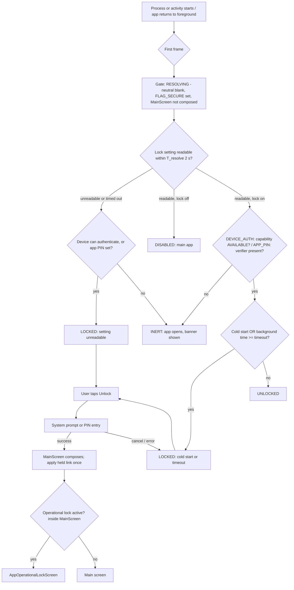
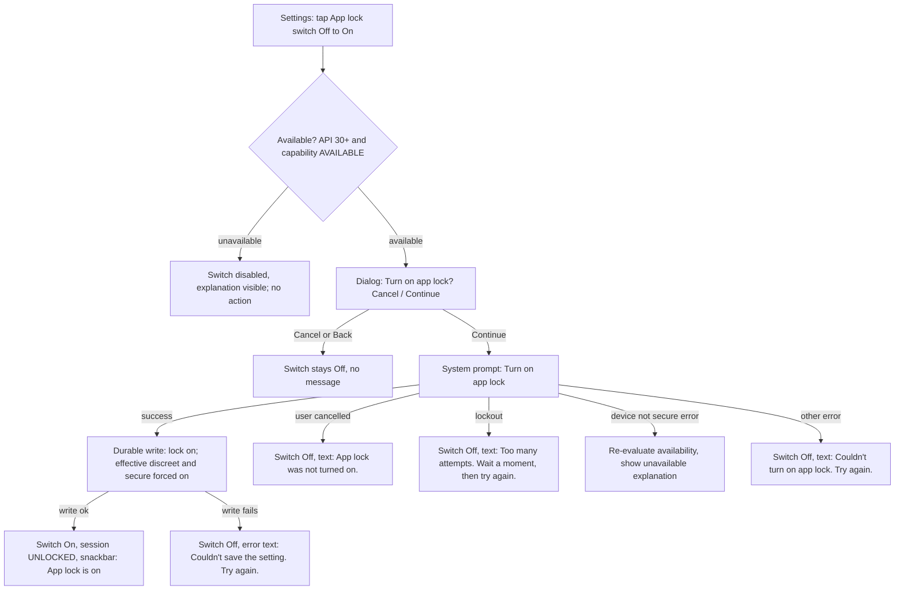
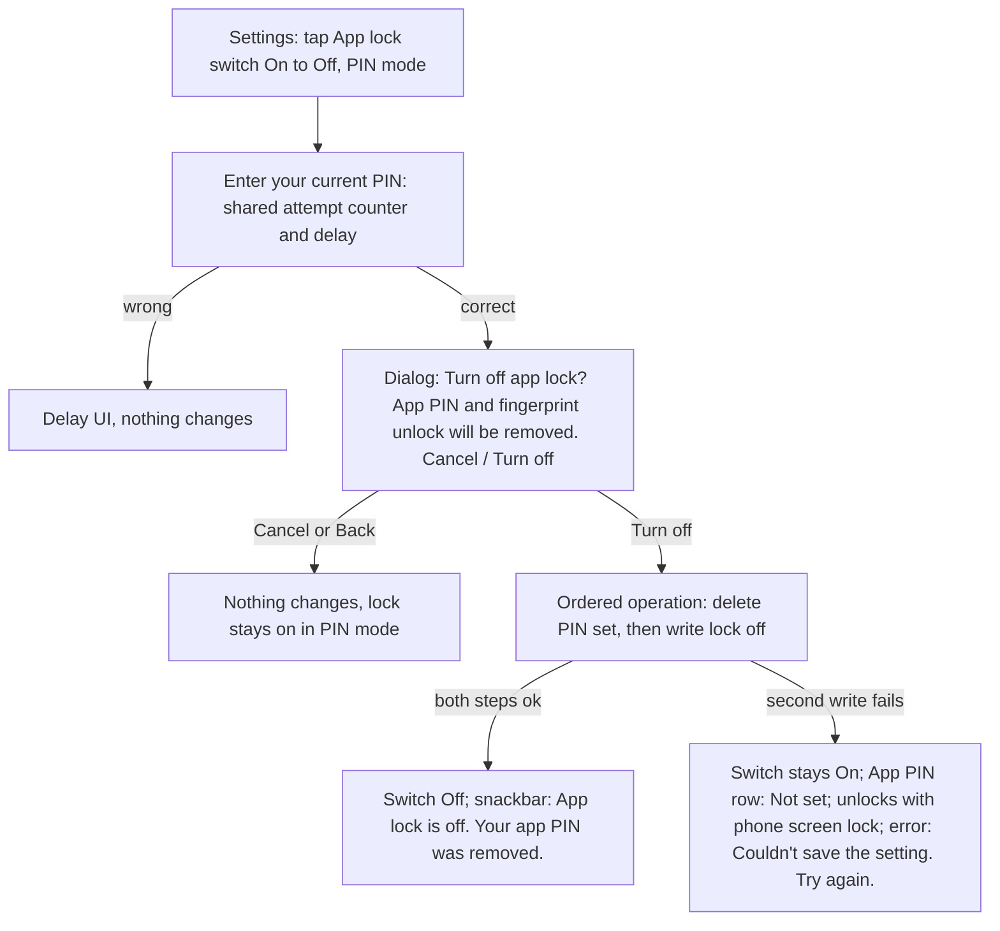
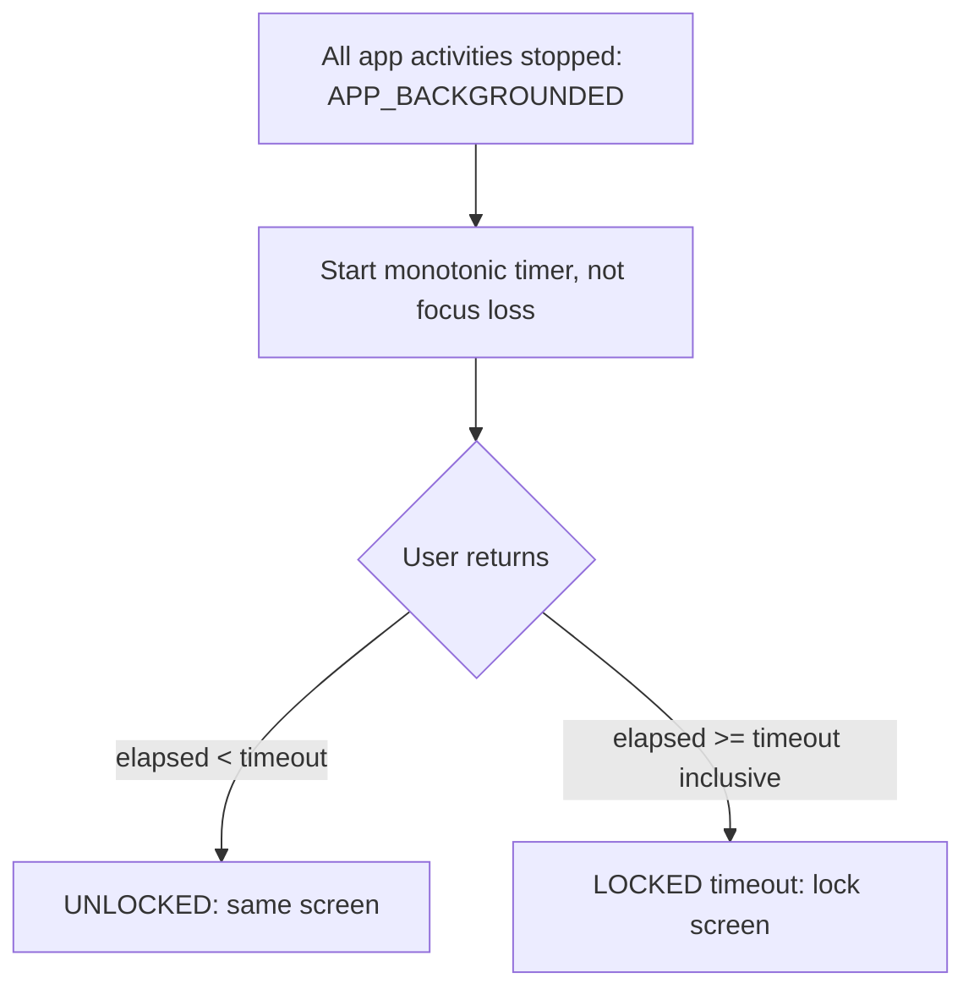
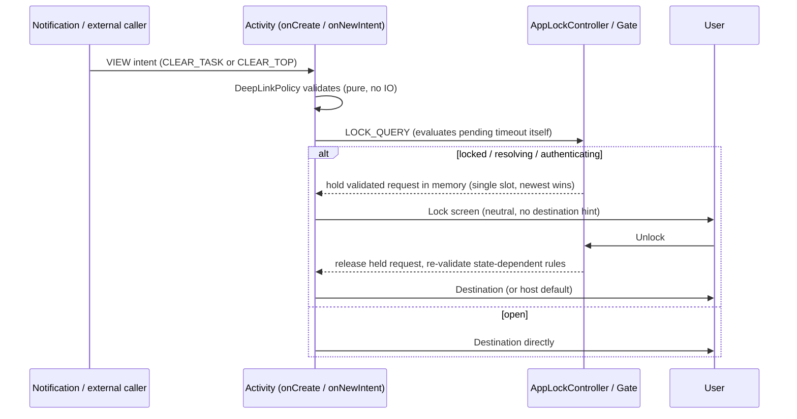
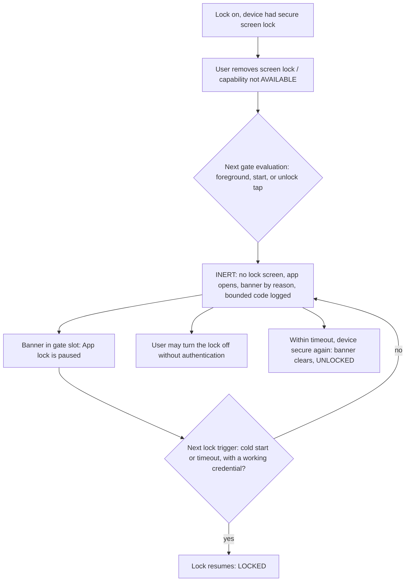
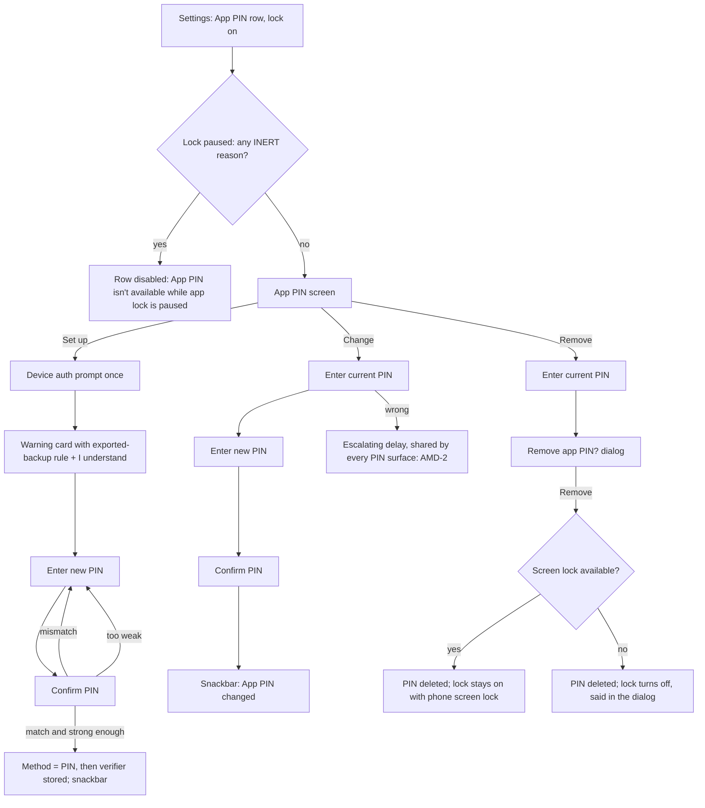
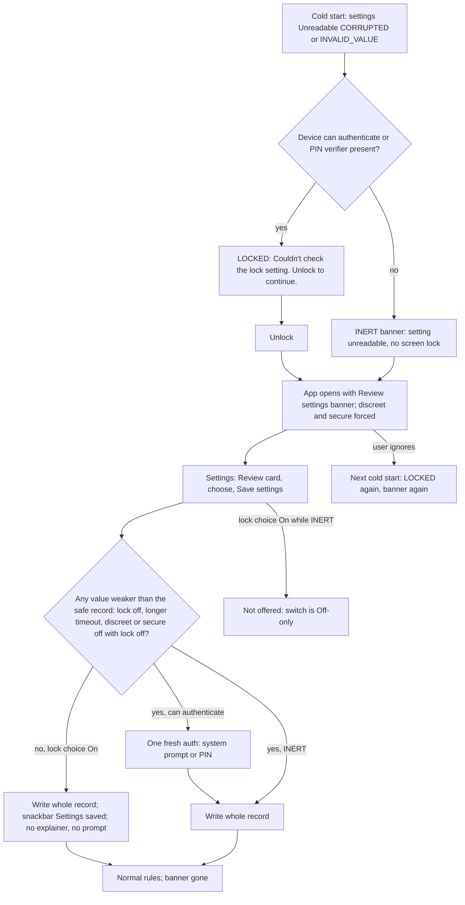

# UX flows: app-lock-privacy-mode — App lock & privacy mode

Author: ux-flow-designer (stage 4), reconciled against `domain-spec.md` (stage 4b, 2026-10-16), then updated for the
Gate 2 decisions and the spec amendment (Gate 2 follow-up, 2026-10-16; see 13.4). Docs-only, post-1.0.
Writes nothing outside this file.
Inputs: `brief.md` (v2, Gate 1 GO), `domain-spec.md` (as amended by AMD-1..16: 52 invariants INV-1..52, 110 acceptance
examples AE-1..110, 21 open decisions OD-1..OD-21), `gate2-decisions.md` (DECIDED 2026-10-16: every row resolves to its
Recommendation), `impact-map.md` (headline 1 and section 9 item 4), `critique.md`, handoff "Human decisions", existing
Compose UI under
`app/src/main/java/com/yourname/expensetracker/ui/` (read: `screens/privacysettings/*`, `MainActivity.kt` operational lock
`:425-449` and `AppOperationalLockScreen` `:1054`, `components/PrivacyBlockedCard.kt`,
`components/NotificationPermissionDialog.kt`, notification builders/workers, `res/values*/strings.xml`).
The first draft of this document was written without the spec. Every rule it assumed is listed as **DD-n** (section 10)
with a reconciliation status; section 13 summarises the reconciliation. Citations use spec ids: INV-n, AE-n, OD-n, T-n
(state-machine transitions), F-n (source facts), R-n (risks).

Binding scope (brief v2): **Inc 1a** discreet notifications + deep-link hardening; **Inc 1b** app lock + forced secure
screen, API 30+ only; **Inc 2** optional app PIN (API 30+, OD-18/INV-43). Hide-amounts is OUT: no masking control, no
"hide amounts" toggle, no masked-amount rendering anywhere in this document. Notification kinds: six (bill, anomaly,
budget, warranty, receipt match, briefing; NEW-1a).

Reference note: `MainActivity.kt`, `HomeScreen`, `PrivacySettingsScreen` and the privacy tile in `FeatureConfig.kt` are
touched by release batches R17/R19/R24. This document names them as hosting surfaces only; the planner must re-read them
at implementation time.

Reading convention for owner decisions: Gate 2 decided every product decision to its Recommendation (OD-1a, 2a, 4a, 5a,
6a, 7a, 8a, 9a, 10a, 13a, 14, 15a, 16a, 17a, 18a, 20a, 21a, NEW-1a; technical ODs 3a, 11, 12 have no UI delta). The flows
below describe only the decided option. The rejected alternatives survive solely as one-line notes in the OD-to-UI table
(12.2), marked "rejected at Gate 2".

---

## 0. Summary of design decisions

1. **One settings section, "App lock & privacy"**, at the top of the existing Privacy Settings screen (after the
   "Disabled Features" cards and error line, before "Notification Capture"). Rows follow the existing
   `SectionHeader` + `ToggleRow` pattern, extended with a supporting-text line and merged row semantics. No new screen
   for 1a/1b settings; only dialogs (the app already uses `AlertDialog` for risky privacy toggles).
2. **The lock gate wraps `MainScreen` from the outside** (spec F5, INV-26, INV-27, proposed guard "`MainScreen(` is invoked
   only from `AppLockGate`"). `MainScreen` is not composed at all in `RESOLVING`, `LOCKED` and `AUTHENTICATING(UNLOCK)`: no
   `ReviewViewModel`, no clipboard read, no permission dialog, no deep-link lookup, no navigation collector (AE-38).
   The settings prompts (`ENABLE`, `CONFIRM_CHANGE`) are the exception: they start from an already open screen, so the
   system prompt is drawn over the composed settings screen and `MainScreen` is neither torn down nor rebuilt (INV-53,
   AMD-22 follow-up). It is
   NOT the same early-return idea as `AppOperationalLockScreen`, which stays inside `MainScreen` and below the gate
   (3.6). The lock screen is a full-screen layout, not an `AlertDialog`, because a dialog is a separate window and the
   lock must be the only composed UI.
3. **Neutral lock screen with one explicit "Unlock" button.** No timed auto-prompt (INV-34: the prompt is launched only by
   explicit user action), no countdown that triggers anything, no content from the app (no counts, badges, names, amounts,
   last-opened screen, or deep-link destination; INV-35).
4. **Authentication UI is the system prompt** (strong biometric or device credential; basic/Class 2 face is not accepted, Class 3 face is allowed by BIOMETRIC_STRONG; INV-23) (corrected 2026-10-28: Class 3 face is allowed by BIOMETRIC_STRONG). The app never
   draws its own fingerprint dialog. In app-PIN mode (Inc 2) the app draws a PIN pad.
5. **Fail-closed in the UI**: while a setting or availability result is unknown, the lock row is disabled with
   "Checking..." and never drawn as Off; an unreadable lock setting shows the lock (if the device can authenticate;
   INV-33).
6. **Honest trade-offs are stated where the choice is made**: screenshots blocked, anyone who knows the phone's screen lock
   can open the app (1b), forgotten app PIN = erase data and recover only from an **exported** `.costbackup` (Inc 2),
   Snooze/Dismiss disappear on Android 11 while the lock is on, lock unavailable on older Android.
7. **No new permissions, no network, no cloud.** Only `USE_BIOMETRIC` (install-time, brief) and two system intents that need
   no permission: security settings and the app's own system "App info" page.
8. **Unlock never replays one-time effects.** After unlock `MainScreen` composes fresh (OD-9), but one-time-per-process
   effects, notably the `POST_NOTIFICATIONS` request dialog (F7, R2), must not run again on every unlock: the user sees
   that dialog at most under the existing/R24 rules, and only after unlock (AE-39), never once per unlock.

### 0.1 Decided at Gate 2 (OD-1..OD-4)

Decided: **OD-1a** Inc 2 app PIN is built, last (with OD-15a, OD-16a and the OD-19 escalation); **OD-2a** discreet
notifications are forced on while the lock is on (INV-6, INV-48); **OD-3a** only BROWSABLE is removed, no user-visible
change (per F9 an installed app can still start `MainActivity` explicitly, so the user-visible rule is the parameter
validation in 2.8, not reachability); **OD-4a** Inc 1a ships ahead of 1b. A 1a-only build shows the section
"App lock & privacy" with the single discreet row and no lock-related copy; strings that mention "app lock" are 1b-only
(see the string table, column "Inc"). Rejected alternatives are noted once in 12.2.

---

## 1. Entry points and navigation

### 1.1 Entry points

| # | Entry | Destination | Notes |
|---|---|---|---|
| E1 | Menu feature tile "privacy" (`FeatureConfig` id `privacy`, `NavigationDestination.PrivacySettings`) -> Privacy Settings -> section "App lock & privacy" | Settings section (2.1) | Only entry for configuration. The tile currently reuses `feature_backup_restore` title/description strings (code comment: "reuse existing string temporarily"); R19 is expected to add a real privacy tile. The spec is silent on this; DD-24 (SPEC-GAP) |
| E2 | Persistent banner in the **gate banner slot** (2.6): inert, "review your privacy settings", "fingerprint unlock turned off". Secondary action opens the settings section | Settings section | The spec places the inert banner slot in `AppLockGate` (8.1: "inert banner slot"), not in Home. This removes the Home-edit collision with R17/R19 (old OQ-8). Open UX question UQ-2 asks whether a strip on every screen is acceptable |
| E3 | Lock screen (2.3/2.4) | Not an entry to settings. The lock screen offers only Unlock (and "Forgot PIN?" in Inc 2) | Deliberate: nothing configurable before authentication |
| E4 | System security settings (`Settings.ACTION_SECURITY_SETTINGS`) and system App info (`ACTION_APPLICATION_DETAILS_SETTINGS`) | OS screens | No permission needed. Return via system Back lands on the app (see 3.8). Counts as leaving the app for the timeout (INV-25, 3.4) |
| E5 | Deep links | NOT an entry for lock settings | There is intentionally no `expensetracker://` host for lock or privacy settings (deep-link surface shrinks, brief goal 2; the host enum in 2.6 of the spec is closed) |

Deep-link-created entries (notifications) are covered in 3.5 and 3.6.

### 1.2 Back behaviour

| Where | Back does |
|---|---|
| Settings section, no dialog | Returns to menu (existing `onDismiss`), unchanged |
| Any dialog (enable explainer, timeout picker, disable, forgot PIN, remove PIN) | Closes the dialog; no state change (same as existing `dismissRiskyConfirm`) |
| System biometric prompt | System handles it; app receives cancelled result (4.3). Back never counts as an error |
| Lock screen (device-credential or PIN) | Sends the task to the background (`moveTaskToBack` semantics), stays locked. It never finishes the activity and never reveals the app. Back does not navigate "behind" the lock because nothing is behind it (not composed; INV-26) |
| PIN setup/change screens (Inc 2) | One step back (Confirm -> Enter), from first step exits and discards everything entered; nothing is persisted until the Confirm step succeeds |
| App-PIN settings screen | Returns to Privacy Settings |

### 1.3 Position restore after unlock (OD-9a, decided)

Locking removes `MainScreen` from composition (3.7 of the spec): composition-scoped coroutines are cancelled, and
in-memory-only UI state of composables that left composition is lost unless the implementation preserves it. Decided
(OD-9a): navigation state and saveable UI state (including pending activity-result registrations) are preserved without
composing. The user-visible promise:

- After unlock the user sees the same destination; in-progress add-expense input and a pending camera/picker result are
  still there.
- Exception: a held deep link (3.5) replaces the destination; a link that is rejected or expired lands on its host
  default.
- Copy consequence: none. The enable explainer needs no extra line about unsaved input.

Long-running operations (backup, restore) continue while locked because they run in ViewModel scope (F21, INV-28). The
lock screen does not mention them (INV-35); after unlock the user sees the existing operational screen if one is
still active (5).

---

## 2. Screens

### 2.1 Privacy Settings - section "App lock & privacy"

**Purpose:** configure discreet notifications (1a), app lock (1b), auto-lock timeout (1b), secure screen (1b), app PIN
entry row (Inc 2).
**Placement:** first section on `PrivacySettingsScreen` `LazyColumn`, after "Disabled Features" and the error line, with
`HorizontalDivider` after it, matching existing section rhythm (`SectionHeader` in `SemanticColors.PrimaryIndigo`,
background `SemanticColors.BaseNavy`, text `TextPrimary`/`TextSecondary`).
**Row component:** the existing `ToggleRow` extended with an optional supporting-text line (`bodySmall`,
`TextSecondary`) and merged semantics (see section 8). Chevron rows reuse the `RawStorageModeRow` density.

Wireframe, Inc 1b complete, lock OFF, API 30+, secure device (default state):

```
+--------------------------------------------------+
| <-  Privacy Settings                              |
+--------------------------------------------------+
| APP LOCK & PRIVACY                                |
|                                                   |
| Discreet notifications                    [ o--]  |
|  Notifications say "Bill due" or "Budget alert"   |
|  instead of amounts, merchants and product names. |
|  Also applies to smartwatches and car displays.   |
|                                                   |
| App lock                                  [ o--]  |
|  Ask for your fingerprint or screen lock when     |
|  the app opens.                                   |
|                                                   |
| Block screenshots and hide in recent apps [ o--]  |
|  Hides the app in the recent apps list and blocks |
|  screenshots, screen recording and casting.       |
|                                                   |
|  Anyone who knows your phone's screen lock can    |
|  unlock the app. Apps with accessibility access   |
|  can still read the screen.                       |
+--------------------------------------------------+
| NOTIFICATION CAPTURE ... (existing sections)      |
```

Wireframe, lock ON (device-credential method, API 31+):

```
| App lock                                  [--o ]  |
|  Ask for your fingerprint or screen lock when     |
|  the app opens.                                   |
|                                                   |
| Lock after leaving the app            1 minute >  |   <- 48dp row, opens picker (2.2b)
|  The app always locks when it starts fresh.       |
|                                                   |
| Discreet notifications                    [--o ]  |   <- checked, DISABLED
|  Always on while app lock is on.                  |
|                                                   |
| Block screenshots and hide in recent apps [--o ]  |   <- checked, DISABLED
|  Always on while app lock is on. You won't be     |
|  able to take screenshots of your own reports.    |
|                                                   |
| App PIN (Inc 2)                       Not set  >  |
|  Use a PIN only you know instead of your phone's  |
|  screen lock.                                     |
|                                                   |
|  Anyone who knows your phone's screen lock can    |
|  unlock the app. Set an app PIN to prevent this.  |
```

API 30 only, lock ON: the lock row gains a second supporting line, because Snooze/Dismiss are not posted (spec 4.4,
INV-10, R9):

```
| App lock                                  [--o ]  |
|  Ask for your fingerprint or screen lock when     |
|  the app opens.                                   |
|  On Android 11, bill reminders don't show Snooze  |
|  or Dismiss while app lock is on.                 |
```

Row order when lock is ON: App lock, Lock-after, Discreet, Secure screen, App PIN (Inc 2), footnote. When lock is OFF,
the Lock-after and App-PIN rows are not rendered (not disabled), because they have no meaning; Discreet and Secure screen
are editable (INV-6, INV-29, 2.3 of the spec: effective values derive from stored value OR lock enabled). The stored
discreet/secure preferences are preserved and shown again when the lock is turned off (effective values are computed,
never persisted; spec 2.3).

When the lock is ON the Discreet and Secure rows are checked and disabled (forced), and their stored values are
read-only while forced (INV-48, AE-103: a write is rejected without any prompt). The stored value applies again when the
lock is turned off.

**App PIN row while the lock is paused (AMD-12, INV-50, AE-107).** The App PIN row is rendered while the lock is on, but
it is **unavailable** while the gate state is any `INERT` reason (including a transferred setting on API 26-29): the row
is disabled, shows no trailing value, and its supporting text reads "App PIN isn't available while app lock is paused."
(`applock_pin_row_unavailable_paused`). Reason: PIN setup needs the lock on, effective device-screen-lock mode, API 30+
and capability `AVAILABLE`, and is never offered in `INERT`. If the lock becomes paused while the App PIN screen is open,
the "Set up app PIN" entry is disabled with the same text. A phone that already has a PIN is never `INERT` (PIN mode
does not depend on the device capability, AE-81), so this state only ever hides the *set up* path.

```
| App PIN                                              |   <- row DISABLED (lock paused)
|  App PIN isn't available while app lock is paused.   |
```

Primary action: the "App lock" switch. Secondary: timeout row, App PIN row, "Open security settings" button
(unavailable states only).

On API 26-29 (OD-20a, decided) both Discreet and Secure rows remain functional (AE-34).

**Unavailable rendering** (lock row only; the rest of the section stays functional):

```
| App lock                                  [ o--]  |   <- switch DISABLED, off
|  App lock needs Android 11 or newer. This device  |      (API < 30; LOCK_UNAVAILABLE_API)
|  runs an older version.                           |
|  [ Open security settings ]                       |   <- TextButton, only if useful
```
```
| App lock                                  [ o--]  |   <- switch DISABLED, off
|  Set a PIN, pattern or password as your phone's   |      (API 30+, capability NO_CREDENTIAL;
|  screen lock to use app lock.                     |       LOCK_UNAVAILABLE_NOT_SECURE)
|  [ Open security settings ]                       |
```
```
| App lock                                  [ o--]  |   <- switch DISABLED, off
|  App lock isn't available right now. Try again    |      (API 30+, capability HW_UNAVAILABLE or UNKNOWN
|  in a moment.                                     |       at enable time; refusal T26, AMD-3, AE-93)
|  [ Try again ]                                    |
```

Brief wording check: "feature unavailable on API < 30 with link to system security settings". The link is offered in the
first two variants. On API < 30 it helps users who want a screen lock for the phone itself; copy does not promise that
it will enable app lock. Discreet notifications and the secure-screen toggle remain available on these versions (AE-34,
OD-20).

**Unavailable but lock stored as ON (transferred setting on API 26-29, AE-54):** the setting can arrive on an unsupported
device only through a device transfer (OD-19). The state is `INERT(API_UNSUPPORTED)`. The row shows the switch ON and
enabled for turning OFF only (T19: no authentication possible), supporting text "App lock isn't supported on this Android
version, so it is paused. Turn it off to remove this notice." plus the inert banner variant for API (2.6). Discreet and
Secure rows stay forced, because the effective values stay forced (INV-32). The App PIN row is unavailable (see above).
The row cannot be turned On again once Off. While the lock is paused (any `INERT` reason) the only lock choice the user
has is Off: turning it Off needs no authentication (T19), and nothing offers On.

**Loading (reading settings):** the existing screen shows a `LinearProgressIndicator` while `isLoading` and renders
defaults. For this section defaults are NOT acceptable: while loading, the "App lock" switch renders disabled, no checked
state is asserted (neither Off nor On), supporting text "Checking...". Discreet and Secure rows render disabled in the same
way. Rationale: an unknown fail-closed lock must never read as Off (INV-2: Unreadable is never collapsed into defaults).
This is a UI-level loading state of the settings screen; it is not the gate's `RESOLVING` state (see 11.2).

**Setting unreadable (fail-closed; INV-2, INV-33).** The spec defines four causes: `IO_ERROR`, `TIMEOUT` (transient) and
`CORRUPTED`, `INVALID_VALUE` (persistent until the user explicitly re-saves). Two renderings:

Transient causes (`IO_ERROR`, `TIMEOUT`):
```
| App lock                                  [ ? ]   |   <- disabled, no checked state shown
|  Can't read the app lock setting. If your phone   |
|  has a screen lock, the app will ask you to       |
|  unlock it.                                       |
|  [ Try again ]                                    |
```
While transient-unreadable every per-field write is rejected (INV-44), so all section rows are disabled. "Try again" is
the settings retry: a successful re-read returns the section to its normal state at once, with no authentication and no
message (T28, INV-47, AE-97); the app also re-reads at each foreground. Transient causes produce no review card and no
banner (INV-51).

Persistent causes (`CORRUPTED`, `INVALID_VALUE`): a review card at the top of the section (not an inline retry, because
re-reading cannot fix it; INV-33 "persists until the user explicitly saves these settings again"). The only accepted
write is one **review-save** of the whole record (INV-44, AMD-1):
```
| +----------------------------------------------+  |
| | (!) Review your privacy settings              |  |
| | The app couldn't read your saved privacy      |  |
| | settings, so it is using the safest options.  |  |
| | Choose your settings below, then save.        |  |
| |                                [ Save settings ]| |
| +----------------------------------------------+  |
| App lock                                  [--o ]  |   <- ENABLED, shows On (the effective safe state)
| Lock after leaving the app          Immediately >  |   <- shown while the lock choice is On
| Discreet notifications                    [--o ]  |   <- checked, DISABLED (forced while the lock choice is On)
| Block screenshots and hide in recent apps [--o ]  |   <- checked, DISABLED (forced while the lock choice is On)
```
Review-save rules as the user sees them (INV-44, INV-45, T27, AE-85..AE-90):
- **"On" is not a separate enable flow.** The lock is already effectively on while settings are unreadable (the
  fail-closed record F: lock on, "Immediately", discreet on, secure on). Saving with the lock choice On, and no other
  value weaker than F, writes the record with no explainer dialog, no system prompt and no "App lock is on" snackbar. The
  snackbar reads "Settings saved" (`privacy_review_saved`). The explainer of 2.2a is never shown from the review card.
- **The lock choice is Off-only while paused.** In any `INERT` state the card's App lock switch is shown Off and
  disabled, with the text "App lock is paused, so Off is the only choice." (`privacy_review_lock_paused`). A record with
  lock On is rejected (`Rejected(CAPABILITY)`, INV-45), so On is never offered. No authentication is asked in `INERT`
  (nothing can authenticate, T19).
- **Weakening saves need one fresh authentication** when the app can authenticate: lock Off, a timeout longer than
  "Immediately", or (with the lock choice Off) discreet or secure screen Off. The authentication is the system prompt
  titled "Change app lock settings", or PIN entry in PIN mode. Cancel or an authentication error leaves the store and
  the card unchanged, no message. A failed write shows "Couldn't save the setting. Try again." and keeps the card
  (INV-46).
- Switching the lock choice to Off makes Discreet and Secure editable (forcing ends); On makes them forced and
  read-only again. The lock choice cannot pick the lock method: the method follows whether a PIN exists (2.3 of the
  spec), and a review-save never enables fingerprint-in-PIN-mode.
- In PIN mode, saving with the lock choice Off runs the PIN-mode turn-off flow (2.2c): PIN entry, then the confirmation
  that the lock turns off and the PIN is removed (INV-49, AE-110). The card shows the line "Turning app lock off also
  removes your app PIN." (`privacy_review_pin_removed_note`) while Off is chosen in PIN mode.
- Until the user saves, discreet and secure stay effective (forced). The card's rows are editable except where forced,
  because the user is being asked to choose; the transient variant shows all rows disabled with "Shown as discreet until
  the setting can be read".

This mirrors the existing `CorruptedFailClosed` idea in `PrivacySettingsViewModel` (`showCorruptionWarning`, currently not
rendered in the screen; the new lock rows must render theirs).

### 2.2 Dialogs from the settings section

All use the existing `AlertDialog` + `TextButton` pattern from `privacy_confirm_*`.

**2.2a Enable explainer ("Turn on app lock?")**, shown after tapping the switch from Off, before the system prompt:

```
+------------------------------------------+
| Turn on app lock?                         |
|                                           |
| - The app asks for your fingerprint or    |
|   screen lock when it opens, and after    |
|   you leave it for the time you choose.   |
| - Notifications show no amounts or        |
|   details while app lock is on.           |
| - Notifications already showing are       |
|   replaced with the private version.      |
| - Screenshots and screen recording are    |
|   blocked and the app is hidden in recent |
|   apps.                                   |
| - Reminders and automatic capture keep    |
|   working while the app is locked.        |
| - Only your screen lock or a strong       |
|   biometric, like your fingerprint, can   |
|   unlock the app. Basic face unlock isn't |
|   used.                                   |
| - (Android 11 only) Bill reminders won't  |
|   show Snooze or Dismiss while app lock   |
|   is on.                                  |
|                                           |
|              [ Cancel ]   [ Continue ]    |
+------------------------------------------+
```
`Continue` uses default text colour (not the error colour used by risky toggles; enabling protection is not risky).
The Android 11 bullet is rendered only when `SDK_INT == 30` (spec 4.4: API 30 + lock on = no actions). The "already
showing" bullet states the decided OD-6a behaviour (silent in-place re-post, INV-13, AMD-7). There is no bullet about
unsaved input, because OD-9a preserves it (1.3). This explainer is shown only for the normal enable flow from the
settings row; it is never shown from the review card (2.1).
The dialog body is scrollable (font scale 200%).

**2.2b Timeout picker ("Lock after leaving the app")**, a radio list in an `AlertDialog` (same radio pattern as
`RawStorageModeRow`, each row min 48dp, full row selectable):

```
| Lock after leaving the app               |
|  ( ) Immediately                          |
|  ( ) After 30 seconds                     |
|  (o) After 1 minute            <- default |
|  ( ) After 5 minutes                      |
|  ( ) After 15 minutes                     |
|  The app always locks when it starts      |
|  fresh.                                   |
|                           [ Cancel ]      |
```
Selecting a radio applies and closes the dialog (same immediacy as the existing sliders and radio rows); no OK button.
Rule from the spec (INV-25, 3.4): the timer starts when the whole app is stopped, using a monotonic clock, boundary
inclusive (elapsed >= timeout locks; AE-40). **The camera, file/image pickers, share sheet and system settings opened
from the app are NOT exempt**: they are subject to the timeout like any other time away. Only the app's own
authentication prompt never re-locks (AE-42). So the helper line shown while an option is highlighted is truthful only in
this form:
- "Immediately": "Locks as soon as you leave the app, including after the camera or a file picker. Choose a longer time
  if you attach photos or receipts often." (`applock_timeout_immediately_hint`)
- "After 30 seconds": "Locks if the camera or a file picker takes longer than this." (`applock_timeout_30s_hint`)
With OD-9a a pending picker result survives the unlock (1.3), so no "can be lost" wording is used in the hints.

Changing the timeout and authentication (OD-8a, INV-3): choosing a **longer** timeout than the current one is a
weakening change and needs a fresh authentication while the lock is enabled (system prompt titled "Change app lock
settings"; PIN entry in PIN mode). Cancel keeps the old value and closes the dialog with no message. Choosing a shorter or
equal timeout applies without authentication. A failed write keeps the previous value and shows the error line (INV-46).

**2.2c Turn off app lock (device screen-lock mode):** switch tap from On -> fresh authentication (system prompt titled
"Turn off app lock", 4.3; OD-8a, T18); on success and after the durable write the switch turns Off and a snackbar shows
"App lock is off". No extra confirm dialog (the prompt is the confirmation; re-enabling costs one more authentication).
Cancel/error leaves the switch On. A failed write leaves it On with the error line (INV-3, INV-46, T18). Side effect: if
stored discreet/secure preferences are Off, they become editable again and revert to their stored values (2.3 of the
spec, INV-48). The snackbar does not mention this; the rows show it.
While the lock is Inert the switch can be turned off with no authentication (T19, nothing can authenticate).

**2.2c-PIN Turn off app lock (app-PIN mode, Inc 2; AMD-4, INV-49, AE-94..AE-96, AE-110).** In PIN mode turning the lock
off also removes the PIN (one ordered operation: the PIN, its attempt state, its fingerprint key and its notice flag are
deleted first, then the lock setting is written). The flow states this before anything is removed:

1. Tap the switch On -> "Enter your current PIN" screen (the PIN pad of 2.4 in a full-screen step; the same wrong-PIN
   counter and delay as unlock, INV-39, AE-91).
2. After a correct PIN, the confirmation dialog (no device prompt; the PIN already proved the owner):

```
| Turn off app lock?                        |
| App lock will turn off, and your app PIN   |
| and fingerprint unlock for the app will    |
| be removed. To use a PIN again, turn app   |
| lock back on and set up a new one.         |
|              [ Cancel ]  [ Turn off ]      |   <- Turn off in error colour
```
3. Turn off -> operation runs -> switch Off, snackbar "App lock is off. Your app PIN was removed." Cancel (or Back) at
   the dialog changes nothing: the correct PIN is discarded and the lock stays on in PIN mode.

If the operation is interrupted or the second write fails after the PIN was deleted, the app shows the committed state:
the switch is still On, the App PIN row reads "Not set", and the app unlocks with the phone's screen lock (device-auth
rules apply when no PIN exists, INV-49). The error line reads "Couldn't save the setting. Try again." Nothing in this
state shows a PIN pad.

The same dialog and snackbar are used by the review card's Off save in PIN mode (2.1). "Remove app PIN" on a phone with
no screen lock has its own wording that also says the lock turns off (2.5d).

### 2.3 Lock screen (device-credential method, Inc 1b)

**Purpose:** gate all app UI. **Composed alone:** nothing else (no dialog, sheet, snackbar host, nav bar, FAB, clipboard
reader, review badge, permission dialog, banner). It is rendered by `AppLockGate` outside `MainScreen`.
**Background:** `SemanticColors.BaseNavy`; text `TextPrimary`/`TextSecondary`; icon `Icons.Default.Lock` (already used by
`PrivacyBlockedCard`), tint `PrimaryIndigo`. No app logo, balance, count, name of the destination.

```
+--------------------------------------------------+
|                                                   |
|                                                   |
|                    [ lock icon ]                  |
|                                                   |
|                    App locked                     |   <- headline, heading semantics
|               Unlock to continue.                 |   <- bodyMedium, TextSecondary
|                                                   |
|           [          Unlock           ]           |   <- Button, min 56dp tall, width <= 360dp
|                                                   |
|        (status message, reserved 2 lines)         |   <- polite live region; empty by default
|                                                   |
+--------------------------------------------------+
```

Layout: single scrollable `Column`, centered, `verticalScroll` so it survives 200% font scale, landscape and multi-window
(split screen, freeform, small windows). The status area reserves space so the button does not jump.

Behaviour:
- Shows immediately on cold start (every process start, including the post-restore restart; INV-25) and on any foreground
  at or after the timeout. No auto-prompt, no timer, no animation that must be waited out. The user taps "Unlock" every
  time.
- Tap -> system prompt (title "Unlock", no subtitle, no description; nothing app-specific in the prompt).
- While the prompt is open the button is disabled to prevent a double launch (INV-34, AE-46); prompt dismissal re-enables
  it.
- After success: lock screen leaves composition; `MainScreen` composes; the held link (if any) applies once (3.5);
  otherwise main screen per OD-9. The `POST_NOTIFICATIONS` dialog or any other one-time prompt is not replayed on unlock
  (OD-9, R2); it may appear only after unlock and only under the existing rules.
- Rotation/theme change: stays locked; process-level lock state, not activity state (INV-24).
- Back: backgrounds the task.
- If the lock screen is shown because the settings could not be read (`LOCKED(SETTINGS_UNREADABLE)`, T5) the status line
  reads "Couldn't check the lock setting. Unlock to continue." If that state came only from a slow start-up read and the
  read then completes with the lock Off (T6b, AE-53), the lock screen disappears and the app opens without any
  authentication. This is intended and not announced. It never happens while the prompt is open, and never when the
  cause was a corrupt or invalid store.

### 2.4 Lock screen (app-PIN method, Inc 2)

Same shell as 2.3 (background, icon, headline area, scroll, Back behaviour). Differences: headline "Enter your app PIN",
a PIN dot display, a number pad, "Unlock" button, "Forgot PIN?" text button, optional fingerprint key.

```
+--------------------------------------------------+
|                    [ lock icon ]                  |
|               Enter your app PIN                  |
|                                                   |
|              o  o  o  o  o  o  (...)             |   <- dots appear as digits are entered, 6..12
|          (status or delay message, 2 lines)       |
|                                                   |
|              ( 1 )   ( 2 )   ( 3 )               |
|              ( 4 )   ( 5 )   ( 6 )               |
|              ( 7 )   ( 8 )   ( 9 )               |
|              (FP )   ( 0 )   ( <x )              |   <- FP only if "Unlock with fingerprint" is on
|                                                   |
|           [          Unlock           ]           |   <- enabled from 6 digits, never auto-submits
|                   Forgot PIN?                     |
+--------------------------------------------------+
```

- PIN length (OD-13a, decided): numeric, 6 to 12 digits. The dot row shows six empty slots and grows with each
  digit up to 12 (wraps to a second row at large font scale). Because length is variable, the explicit "Unlock" button is
  required (no auto-submit), and it is enabled from the sixth digit.
- The in-app pad is recommended over the system keyboard so a third-party keyboard never sees the PIN (UQ-1; the spec
  requires the PIN never to reach logs/saved state, INV-38, and does not choose the input surface).
- Keys: min 64dp circles (above the 48dp minimum). Digit order is fixed (no randomised layout; a randomised pad hurts motor
  and TalkBack users more than it helps against shoulder-surfing at this threat level).
- No timed behaviour except the enforced delay (4.4), which is a lockout, not an auto-action.
- "Forgot PIN?" opens the Forgot dialog (2.5d). The PIN screen never offers "Use screen lock instead" (INV-40: in `APP_PIN`
  mode the device credential never unlocks; with the PIN unreadable there is also no fallback under OD-15a, see 4.4).
- While a delay is active the keys and Unlock are disabled, dots cleared, message shows the remaining time (4.4). The
  rejection is also enforced in the logic (T25), not only in the UI.
- Fingerprint key (if opted in, OD-16a): opens the system prompt restricted to strong biometrics only, with a negative
  button "Use PIN". It never offers the device credential. It is tapped by the user; it is never auto-launched (INV-34).
- PIN mode keeps working if the phone's screen lock is removed after the PIN was set; the Inert escape does not apply
  (INV-40, AE-81). A phone with no screen lock cannot start in PIN mode, because PIN setup needs the lock on in
  screen-lock mode with an available capability (INV-50).

### 2.5 App PIN screens (Inc 2)

2.5a **App PIN settings screen** (full screen, reached from the App PIN row; follows the same TopAppBar pattern as
Privacy Settings):

```
+--------------------------------------------------+
| <-  App PIN                                       |
+--------------------------------------------------+
| STATUS                                            |
|  App PIN is on.  (or "App PIN is off.")           |
|                                                   |
| Change app PIN                                  > |  <- only if set
| Remove app PIN                                  > |  <- only if set
| Set up app PIN                                  > |  <- only if not set
|                                                   |
| Unlock with fingerprint                   [ o--]  |  <- only if PIN set; default Off
|  Any fingerprint saved on this phone will open    |
|  the app, including other people's.               |
|                                                   |
|  Forgot your PIN? The only way back in is to      |
|  erase the app's data in Android settings. Only   |
|  a backup file you exported (.costbackup) and     |
|  its password can bring your data back. Keep one  |
|  outside this app. A backup doesn't contain your  |
|  PIN or app lock settings.                        |
+--------------------------------------------------+
```

Turning "Unlock with fingerprint" On requires the current PIN first (spec 6.3). If no strong biometric is enrolled the row
is disabled with "No fingerprint is set up on this phone." The "any fingerprint" warning is true at enable time, and (OD-16a,
decided) the row has a second line: "If a fingerprint is added to this phone later, this is turned off and your PIN is
needed." (`applock_pin_fingerprint_invalidation_note`).

2.5b **Set up app PIN** (3 steps, each a full screen with TopAppBar "Set an app PIN"). Preconditions (INV-50, AMD-12): the
lock is on in screen-lock mode, the app is unlocked, API 30+ and the device capability is available. The "Set up app
PIN" entry is disabled while the lock is paused (2.1) and is never offered when the lock is off.

Step 0 - warning and acknowledgement (spec 6.5: the PIN setup screen must state the recovery rule before the first PIN
is saved):
```
|  Choose a PIN of 6 to 12 digits. It's asked for   |
|  instead of your phone's screen lock when you     |
|  open this app, which helps keep out people who   |
|  know your phone's screen lock.                   |
|                                                   |
|  +--------------------------------------------+   |
|  | If you forget this PIN, the only way back  |   |   <- card styled like PrivacyBlockedCard
|  | in is to erase the app's data. Your data   |   |      (icon + text), warning not error
|  | can then only be restored from a backup    |   |
|  | file you exported (.costbackup), with its  |   |
|  | password. Backups kept only inside the app |   |
|  | are erased too.       [ Back up now ]      |   |   <- navigation only -> Backup & Restore route
|  +--------------------------------------------+   |
|  [ ] I understand I may lose my data if I forget  |   <- checkbox, row min 48dp
|      my PIN and have no exported backup           |
|              [        Continue        ]           |   <- disabled until checked
```
The card button is labelled "Back up now" in the string table and opens the existing Backup & Restore screen (the
implementer verifies that an export-to-file action is reachable there; the spec says only exported copies survive "clear
data", F3, so an internal-only backup does not count). The shortcut is navigation only: it never starts a backup. The app
does not tell the user whether an exported backup already exists (AMD-9, AE-104: scope growth S8, not designed).

Step 1 - "Enter a new PIN" (dots + pad + "Next", enabled from 6 digits). Step 2 - "Confirm your PIN" (dots + pad + "Set
PIN").

Validation messages (resource-backed): "PINs don't match. Try again." (stays on step 2, cleared; second mismatch returns to
step 1); "Choose a PIN that's harder to guess." (all-same digits or simple sequences, OD-13a).
Success: back to App PIN settings screen, snackbar "App PIN is set". Lock method becomes PIN immediately. Setup needs one
fresh device authentication first (`CONFIRM_CHANGE`, INV-50, T31): the system prompt is shown once before step 1.
Interrupted setup (Back, process death, rotation) leaves the lock method unchanged: the device screen lock still applies
until the PIN is stored (INV-50 commit order, INV-3).

2.5c **Change app PIN:** "Enter your current PIN" (spec 6.4: requires the current PIN) -> "Enter a new PIN" -> "Confirm
your PIN" -> snackbar "App PIN changed". No acknowledgement step. Wrong current-PIN entries share the unlock attempt
counter and delay (AMD-2, INV-39, AE-91, AE-92), so the same delay UI (4.4) is shown on every PIN-entry surface (change,
remove, turn off, enable fingerprint, review-save), and a correct PIN anywhere resets the counter.

2.5d **Remove app PIN / Forgot PIN dialogs:**
```
| Remove app PIN?                           |
| The app will unlock with your phone's      |
| screen lock instead.                       |
|                    [ Cancel ]  [ Remove ]  |   <- Remove in error colour; requires current PIN first
```
Remove requires "Enter your current PIN" first (INV-42, AE-82), then this dialog. Removal is one ordered operation that
deletes the PIN and then writes the settings (INV-49, AMD-4, AE-94..AE-96). It asks for no device prompt. Two outcomes,
decided by the device capability when the user taps Remove:
- Screen lock available: the lock stays on and unlocks with the phone's screen lock (the body above). Snackbar "App PIN
  removed" (`applock_pin_snackbar_removed`).
- No screen lock (capability not available): the lock turns off, because a screen-lock lock could not authenticate and
  the spec forbids leaving one enabled (INV-49, INV-23). The body adds "Your phone has no screen lock, so app lock will
  turn off." (`applock_pin_remove_body_no_secure`), and the snackbar is "App lock is off. Your app PIN was removed."
  (`privacy_app_lock_snackbar_off_pin_removed`).

```
| Forgot your app PIN?                      |
| For your privacy, the app PIN can't be     |
| reset. To get back in, clear the app's     |
| data in Android settings. This erases      |
| everything stored in the app on this       |
| phone. Only a backup file you exported     |
| (.costbackup), with its password, can      |
| bring your data back. Without one, it      |
| can't be recovered.                        |
|        [ Cancel ]  [ Open app settings ]   |   <- ACTION_APPLICATION_DETAILS_SETTINGS
```
The app never erases its own data and never wipes after failed attempts (INV-39, AE-75). Erasure happens only in Android's
own settings; there is no in-app erase button and no in-app reset (INV-42; old OQ-8 part two is resolved by the spec, an
in-app erase would be scope growth with its own legal path). A backup does not contain the PIN or the lock settings (F1):
after clearing data the app starts with lock Off and no PIN (AE-77).

### 2.6 Banners and notice cards

All banners render in the **gate banner slot**: a slim strip at the top of the app shell, above `MainScreen` content,
owned by `AppLockGate` (spec 8.1). One banner at a time, priority: Inert > Review settings > Fingerprint turned off.
Never shown on the lock screen (2.3 is composed alone). Reuse the visual pattern of `PrivacyBlockedCard` (Card, leading
icon, title `titleSmall`, body `bodySmall`, trailing `TextButton`) with a neutral/warning container colour instead of
`errorContainer`, because these are not user errors. Whether to generalise `PrivacyBlockedCard` or add a small sibling is
an implementer decision.

| Banner | Text | Actions | Dismissible | Spec cause |
|---|---|---|---|---|
| **Lock paused: no screen lock** (`INERT(NO_CREDENTIAL)`) | Title "App lock is paused". Body "Your phone no longer has a screen lock, so the app can't ask you to unlock it. Set a screen lock to turn protection back on." | "Open security settings", "App lock settings" | No (persistent while INERT; clears when the app next opens or returns with a working screen lock, T15) | INV-32, AE-48 |
| **Lock paused: can't check right now** (`INERT(HW_UNAVAILABLE)`, `INERT(UNKNOWN)`) | "App lock is paused" / "Your phone can't check your screen lock right now, so app lock is paused. It turns back on the next time the app locks." | "App lock settings" | No | INV-32 (any capability other than AVAILABLE; R7 accepted trade-off) |
| **Lock paused: Android version** (`INERT(API_UNSUPPORTED)`) | "App lock is paused" / "App lock isn't supported on this Android version, so it is paused. You can turn it off in settings." | "App lock settings" | No | INV-32, AE-54 |
| **Lock paused: setting unreadable, no screen lock** (`INERT(SETTINGS_UNREADABLE_NO_AUTH)`) | "App lock is paused" / "The app couldn't read your app lock setting and your phone has no screen lock, so app lock is paused." | "Open security settings", "App lock settings" | No | T6, AE-52 |
| **Review settings** (after unlock from `LOCKED(SETTINGS_UNREADABLE)` with cause CORRUPTED or INVALID_VALUE) | "Review your privacy settings" / "The app couldn't read your saved privacy settings, so it is using the safest options until you review them." | "Review settings" | No (until a review-save succeeds; returns on every cold start until then, INV-33, INV-51) | AE-51, AE-99 |
| **Fingerprint turned off** (PIN mode, OD-16a) | "Fingerprint unlock turned off" / "A fingerprint was added to this phone, so fingerprint unlock for the app was turned off. Your PIN is needed." | "App PIN settings" | Yes (acknowledge once; backed by a persisted pending flag, so process death does not lose it, INV-51) | AE-76, AE-100, `PIN_BIOMETRIC_INVALIDATED` |

At most one notice is shown at a time, in open states only (INV-51, AE-99..AE-101). A lower-priority notice waits and is
not dropped. The inert and review notices cannot be dismissed. Transient unreadable causes produce no notice.

Inline notices (not banners): unavailable-on-this-Android-version and unreadable-with-retry live inside the App lock row
(2.1).

Slot placement vs precedence (INV-52, AMD-13): the spec renders `AppOperationalLockScreen` inside `MainScreen`, so a
gate-level strip may also sit above the operational screens. While the operational state is Restore in progress, Restart
required or Critical recovery, a notice stays visible but offers **no in-app navigation action** and enqueues no
navigation request: "App lock settings", "Review settings" and "App PIN settings" are hidden, and only system-intent
actions ("Open security settings") remain (AE-108). In-app actions return when the state is normal or a backup is
exporting. Where the strip is visible (every screen or only Home and settings) stays UQ-2.

### 2.7 Notifications (Inc 1a)

**Policy shown to the user:** three content tiers per notification kind (spec 4.2, 4.3), six kinds (NEW-1a):
- **Normal** (discreet off, lock not enabled, settings readable): today's text. Unchanged by this feature.
- **Discreet** (discreet on, OR lock enabled including paused/unsupported, OR settings unreadable/timed out): constant
  text per kind that names the kind only, generated content-free and never derived from detailed text (INV-5, INV-6,
  INV-8).
- **Public version** (always attached, both modes, INV-7; OD-21a decided): **one generic text pair, identical for all six
  kinds and naming no kind**: title "Reminder", text "Open the app to see details." No actions, no expanded style. The
  system shows it only when the user's lock-screen setting is "hide sensitive content". So on a lock screen set to hide
  sensitive content, a bill, a budget alert and a receipt match all read the same; on a lock screen set to show all
  content the user sees the kind's discreet text instead. Visibility is always private (`VISIBILITY_PRIVATE`); no
  notification is ever made public.

The generic pair is a single app-wide constant pair (`notif_public_title`, `notif_public_text`), not per kind. It follows
brief v2's "generic public version" literally (AMD-14, AE-109). This resolves former flag R-1 (12.3).

The spec allows the copy to name the **kind only** (OD-10a) and forbids amounts, currency, merchant, product, category,
severity, window or dates, counts and AI text. Final discreet copy (the spec's wording is illustrative; this document owns
it), no emoji:

| Kind (channel) | Normal today (source) | Discreet title | Discreet text | Public version (hide-sensitive lock screen) |
|---|---|---|---|---|
| Bill reminder (`BillReminderWorker`, bill channel) | "{merchant} due: {amount} {currency}" (`BillReminderWorker.kt:185-193`) | "Bill due" | "Open the app to see details." | "Reminder" / "Open the app to see details." |
| Anomaly (`AnomalyAlertOrchestrator`, anomaly channel) | Title "Unusual Charge Detected", text "Unusual charge: {amount} at {merchant} ({reason}). Tap to review." | "Unusual charge detected" | "Open the app to review." | same generic pair |
| Budget (`BudgetMonitor`, budget channel) | Title "Budget Warning"/"Critical Budget Warning", text "You've spent {sym}{n} ({p}%) of your {category} budget ({sym}{limit})." | "Budget alert" | "A budget needs your attention. Open the app to review." | same generic pair |
| **Warranty (own kind `WARRANTY`, budget channel)** (`WarrantyExpirationWorker`) | Title "Warranty Expiring Soon"/"Warranty Expiration Reminder", text "{product} warranty expires in 7 days ({merchant})" | "Warranty reminder" | "A warranty needs your attention. Open the app to review." | same generic pair |
| **Receipt match (own kind `RECEIPT_MATCH`, budget channel, NEW-1a)** (`ReceiptMatchingWorker`, posted via `postBudgetAlert`, `ReceiptMatchingWorker.kt:108`) | Title "Receipt Auto-Matched" (with a leading check-mark emoji today), text "Receipt from {merchant} matched to transaction automatically" | "Receipt matched" | "Open the app to review." | same generic pair |
| AI briefing (`DeliverProactiveBriefingNotificationUseCase`, AI channel) | Title "Your AI briefing is ready", text = first 180 chars of AI summary | "Your AI briefing is ready" (see below) | "Open the app to read it." | same generic pair |

**Briefing discreet title (settled here; the spec table said "Your briefing is ready").** This document owns the copy and
keeps **"Your AI briefing is ready"**. Why: (1) the Normal title is already content-free (no amount, merchant, product or
AI text), so Normal and Discreet titles stay the same and nothing changes visibly for the user when discreet turns on;
only the body text is replaced, which is the part that leaks; (2) it is the string the app posts today, so Normal mode
is untouched and there is no second wording to translate and keep in step; (3) it names the kind only (OD-10a allows
that). Trade-off accepted: the word "AI" is visible on the private version to a bystander who can see the shade; the
public version hides it. **The domain spec 4.3 table should be changed to match** ("Your AI briefing is ready" / "Open
the app to read it."), and the spec's other illustrative discreet texts ("Unusual charge" / "Open to review", etc.)
should be replaced by a pointer to the 9.4 string table, since the spec states that this document owns the wording.

Notes:
- Warranty is its own kind: the worker must pass `WARRANTY`, not post as an implicit budget (F15, INV-12). It still posts to
  the budget channel; the system shows the channel name in notification settings, not on the notification itself, so the
  user sees no change. A warranty notification never reads as "Budget alert" in discreet mode (AE-5).
- Receipt match is also its own kind (NEW-1a, impact-map headline 1): today the worker posts through the budget path and
  the merchant name reaches the lock screen. The worker must pass `RECEIPT_MATCH`. It stays on the budget channel with
  its existing tap target, so the user sees no channel or navigation change. A receipt-match notification never reads as
  "Budget alert" in discreet mode, and a receipt-match notification never shows the merchant once discreet applies. The
  spec still lists five kinds (INV-12, AE-13, 2.5, 4.3) and must be amended to six (13.4).
- Budget Warning vs Critical Warning severity is dropped in discreet mode (OD-10a: kind only; AE-4 shows identical text
  for 80%, 95%, 110%). Same for the partial-data qualifier and the 7-day vs 30-day warranty distinction.
- Expanded (BigText) style on anomaly and briefing is used only in Normal mode; in Discreet mode there is no expanded
  style, so the expanded view cannot leak (INV-8, 4.3). Implementation note, not a UX choice.
- The bill notification has no tap target today (`setContentIntent` is absent, `BillReminderWorker.kt:253-261`, F16). This
  flow does not add one (spec S4: unchanged). Tapping a bill notification does nothing; the lock behaviour of 3.6 does not
  apply to it.
- The capture foreground-service notification keeps its constant generic text in every state and is not a kind
  (INV-12, AE-13).

Lock-screen / shade mockups, discreet on. Left: lock-screen setting "show all content" (private version, kind text).
Right: lock-screen setting "hide sensitive content" (public version, one generic pair for every kind, no actions):
```
[icon] Expense app  now                          [icon] Expense app  now
Bill due                                         Reminder
Open the app to see details.                     Open the app to see details.
[ Snooze ] [ Dismiss ]   (see matrix below)      (public version: no actions, same text for every kind)
```

**Bill notification actions (Snooze / Dismiss mutate reminder lifecycle state).** Rules from spec 4.4 / INV-10 / OD-5a
(decided):

| Lock | Android | Actions posted on the private version | User experience |
|---|---|---|---|
| Off, settings readable | 26-30 | "Snooze" and "Dismiss", unchanged | Tapping works from the lock screen without any unlock. Not changed by this feature |
| Off, settings readable | 31+ | Both posted with "authentication required" **even with lock off** (OD-5a, from Inc 1a) | A behaviour change visible to **all** existing users: on a locked phone, Snooze/Dismiss first ask for the phone's own unlock, then run. On an unlocked phone they run at once. Needs a release note (text in 9.5; APP-4) |
| On (device auth or PIN mode, OD-17a) or settings unreadable | 31+ | Both posted with "authentication required" | Phone unlock first (the phone's own keyguard, not the app lock screen); actions are background actions and show no app UI |
| On or settings unreadable | 30 | **None** (`NOTIF_ACTIONS_SUPPRESSED_LOCK`) | The notification shows only its text. To act on it the user opens the app (lock screen first, then Bill reminders). There is no in-app Snooze/Dismiss (F16, R9), so on Android 11 the user cannot snooze or dismiss bills while the lock is on; the enable explainer and the lock row state this (2.1, 2.2a). An in-app equivalent is scope growth S2, not designed |
| Inert via transferred setting | 26-29 | None (as the API 30 row, AE-54) | Same as above |

Public versions never carry actions on any API. PIN mode keeps the actions, phone-unlock-required on 31+ (OD-17a).

Notifications already in the shade when discreet mode or the lock is switched on (OD-6a decided, INV-13, AMD-7): they
are replaced in place by the kind's discreet version (same id, same tap target, action policy re-applied, so on API 30 an
old bill notification loses its actions). The replacement is **silent**: no sound, vibration, light or heads-up, and the
original post time is kept where the platform allows, so shade order does not change (AE-102). It runs only after the
setting change is committed, only for notifications that are still showing, and it never counts as a new delivery. If
one cannot be replaced it is skipped without any message. Turning discreet off never re-posts. This reverses the first
draft's assumption (DD-23).

Action labels are hardcoded English in `BillReminderWorker` today ("Snooze", "Dismiss"). Moving them to resources is
recommended with 1a (strings `notif_action_snooze`, `notif_action_dismiss`; `action_dismiss` already exists).

**What users never see:** no in-app message announces that a notification was made discreet; the behaviour is explained by
the settings helper text only. Failure to read the setting posts the discreet version silently and never blocks or delays
posting (INV-9, AE-7, AE-8).

### 2.8 Deep links (Inc 1a hardening) - what the user sees

Every incoming `expensetracker` link is untrusted, internal notification taps included (spec 5.1): removing BROWSABLE stops
browser-originated links (AE-16: the app does not open), but an installed app can still start `MainActivity` explicitly
(F9). The rules the user can observe are the per-host defaults:

| Host | Valid link | Invalid/dropped parameter, lookup failure or rejection |
|---|---|---|
| `home`, `dashboard` | Home (briefing marked opened only if `briefingKey` equals the last delivered briefing key, INV-16) | Home. A well-formed but not-delivered or unreadable-state key: Home, nothing written, no message (AE-17, AE-20). The briefing is still delivered later |
| `activity` (`expenseId`) | Transactions filtered to the local day of the expense (AE-22) | Transactions list, unfiltered (`expenseId` malformed, expense not found, read blocked; AE-23, AE-24). No message |
| `review`, `plan` | Review, Budget | n/a (no parameters) |
| `add` | An **empty** add sheet; extra parameters are ignored, nothing is prefilled or created (INV-17, AE-27). Clipboard behaviour is unchanged and runs only in open UI states | Add sheet |
| `analytics` (`period`) | Analytics with that period (case-insensitive allowlist, AE-25) | Analytics default period |
| `map` (`location`) | Map with a local highlight | Map without highlight (AE-26) |
| Bank hosts | n/a | Home (RP-17, AE-28) |
| Unknown host, malformed structure (path, fragment, userinfo, port, > 2048 chars) | n/a | Home (AE-29, AE-30) |
| Non-VIEW intent carrying a link | n/a | Ignored: normal launch, nothing applied (AE-31) |

No toast, no dialog, no error text for any rejection: an error message would confirm to a probing caller that the link was
parsed. A bounded reason code goes to diagnostics, never the value (INV-18, AE-21). User-facing copy never contains a link,
parameter, `briefingKey` or `expenseId`.

Superseded first-draft statement: invalid parameters do not always land on Home; they land on the host's default (table
above, spec 5.3).

A valid link arriving while locked is held and applied after unlock (3.5). While locked nothing about the destination is
drawn.

---

## 3. Flows

### 3.1 App start / foreground gate (all lock behaviour)



"Resolving" composes nothing financial and `FLAG_SECURE` is already set (spec T1, INV-29), so recents stay blank even for
the first frame. It uses the same `BaseNavy` background as the Locked screen so there is no flash of a different colour.
It is bounded: at `T_resolve` (recommended 2 s) the gate falls to a fail-closed outcome (Locked with the "can't check the
setting" status if the device can authenticate, otherwise Inert); it never stays blank indefinitely and never opens the app
on a timeout. A late successful read with lock off (T6b) then opens the app without authentication.

### 3.2 Enable app lock


While the system prompt is shown (and while the Disable / confirm prompts of 3.3 and 2.2b are shown) the settings screen
stays composed underneath: nothing flashes, resets or re-runs, and the lock screen is not shown (INV-53, AE-113, AE-114).
If the user backgrounds the app during the prompt, the system cancels it: the switch stays Off with nothing saved, and the
background goes to the timer (3.8; T34). Only an `UNLOCK` prompt ever sits over the lock screen.
Only one successful authentication is needed (INV-23). The user is NOT locked out immediately after enabling: the session
that just authenticated counts as unlocked (T17, AE-36). The write is durable before any effect (INV-3): interruption before
the write leaves the lock off, after the write the next start locks. If notifications are re-posted in place (OD-6a) it
happens silently after the write.

### 3.3 Disable app lock

Device screen-lock mode: tap switch On to Off -> fresh authentication, system prompt "Turn off app lock" (OD-8a, T18) ->
durable write -> snackbar "App lock is off". Cancel/error or failed write: stays On (AE-70). If the lock is Inert (device
cannot authenticate) the switch can be turned off without any authentication (T19).

PIN mode (Inc 2; AMD-4, INV-49): the PIN is removed together with the lock, and the flow says so before anything changes.


No device prompt is asked (the PIN already proved the owner, spec 6.4).

### 3.4 Return to app within vs after the timeout


The timer never starts on focus loss, split-screen, the notification shade, configuration changes or the app's own auth
prompt (INV-25, AE-41, AE-42). Wall-clock changes have no effect (monotonic, AE-43). **There is no exemption for the
camera, pickers, share sheet or system settings** (spec 3.4): they are ordinary time away. The first draft's recommended
"suspend the timer for self-initiated external activities" is not adopted. Consequences are in 1.3 (OD-9) and 2.2b (hints).

### 3.5 Deep link or notification tap arriving while locked


What the user sees after unlock (INV-30, INV-16, spec 5.5):

| Situation | After unlock |
|---|---|
| Valid link held | The destination, applied exactly once, even if the device was rotated meanwhile (AE-55). Preserved navigation (OD-9a) is replaced by the link's destination |
| Second link while locked | Only the newest applies (AE-56); no message |
| `briefingKey` equals last delivered | Home; briefing marked opened (invisible) |
| `briefingKey` well-formed but not the last delivered, or engagement state unreadable | Home, nothing written, no message. Tapping a stale briefing notification after a newer briefing was delivered therefore does not suppress the newer one |
| Link rejected or parameter invalid | The host default (2.8) |
| Held for longer than the expiry (OD-7a decided: 5 min) | Home (AE-60), no message |
| Process died while locked | Start destination (Home) after unlock, no message (AE-57) |
| `LOCK_QUERY` ordering | A tap after a long background cannot apply before the lock engages: the lock shows first (AE-58) |
| Tap within the timeout with CLEAR_TASK (budget, warranty) | A new activity starts with no lock screen and shows Home (AE-59) |

Device keyguard first, then app lock: tapping a notification on a locked phone shows the phone's own unlock, then the app
lock screen. Two authentications is expected friction; no grace between them is designed and the app never prompts
automatically (INV-34).

### 3.6 Bill / budget / anomaly / warranty / receipt-match / briefing notification tap while lock is on

Same as 3.5. The bill notification has no tap target (2.7). Receipt-match uses its existing (budget-path) tap target
(NEW-1a). Snooze/Dismiss per the 2.7 matrix.

### 3.7 Post-restore restart

The restore flow ends on `RestartRequiredAfterRestore` ("Restart Required" / "Restart Now" -> `Runtime.exit(0)`), a cold
start. On the next launch the user sees the app lock screen (if lock is on, every process start locks, INV-25, AE-61),
then the normal start. Lock settings and the PIN are device-local and excluded from `.costbackup` (INV-1, F1), so a restore
never changes the lock setting or the PIN: a backup taken with lock off restores into a lock-on install and the lock stays
on (AE-61); after an in-app restore on a PIN-protected install the same PIN is required (AE-78). No text is added to the
existing restart screen.

### 3.8 Returning from system screens, multi-window, process events

| Situation | Behaviour |
|---|---|
| System security settings / App info opened from the app (E4) | Ordinary time away; the timeout applies. With "Immediately" or a short timeout the user sees the lock screen on return. Expected; no exemption |
| Camera, file/image picker, share sheet, document export launched by the app | Ordinary time away; the timeout applies (3.4). Result survives or not per OD-9 |
| App's own biometric prompt | Never re-locks; prompt dismissal returns to the lock screen or settings as before (AE-42) |
| Runtime permission dialogs (R24 POST_NOTIFICATIONS, R17 listener access screen) | Shown only after unlock and not replayed on every unlock (OD-9, R2). Listener-access settings screen is a system screen: timeout rule applies on return |
| Split-screen / freeform / small window, focus moves to the other app | Focus loss alone never starts the timer; only a full stop. Visible-but-unfocused app stays unlocked |
| Lock screen shown in a small window | Scrolls; button remains reachable (verticalScroll, no fixed heights) |
| Screen off / power button | Counts as a stop; timer applies on next foreground |
| Rotation, dark/light, font scale change | No state change: locked stays locked, unlocked stays unlocked (INV-24) |
| Process death while unlocked | Next start is a cold start: locked |
| Unlock prompt (`AUTHENTICATING(UNLOCK)`) open when app goes to background | System cancels it; user returns to the lock screen with no message (3.5 of the spec; T9) |
| Settings prompt (`ENABLE` / `CONFIRM_CHANGE`) open when app goes to background (AMD-22 follow-up) | System cancels it. On return the user is back on the settings screen (still composed, INV-53) with nothing saved and no message, or sees the lock screen if the timeout has passed on return (the first background of the attempt goes to the timer, T32, T34, INV-54, AE-116). From `ENABLE` (lock was off) there is no timer, so the user is simply back on settings with the switch Off. If the platform keeps the prompt alive (an OEM credential UI) and it then succeeds, the change applies and that background is discarded: no re-lock loop (T33, AE-42, AE-117). Rotation is not a background and keeps the prompt (T35) |
| Activity hosting any prompt destroyed (not a rotation) | The attempt ends as cancelled; the Unlock button or settings switch is enabled again, no message (T35, AE-118) |
| Restore or backup running when the timeout expires | Lock screen replaces the UI; the operation continues; after unlock the operational screen shows if still relevant (5) |

### 3.9 Inert lock (device cannot authenticate) transitions


Changed from the first draft (DD-4, DD-11): the spec treats **any** capability other than `AVAILABLE` as Inert, including a
transient `STATUS_UNKNOWN` or hardware-unavailable result (INV-32; accepted trade-off R7, monitored by `LOCK_INERT_*`
counts). A transient **prompt** error, by contrast, only leaves the app Locked (T10); only a re-check that says "not
available" (T11) leads to Inert. Re-activation happens only at the next lock trigger, never mid-session, and the lock
setting itself is never auto-disabled. Re-adding a screen lock inside the app leaves the banner for the rest of the
session (AE-49); coming back from system settings within the timeout clears the banner (T15), after the timeout the lock
screen shows.

### 3.10 App-PIN setup, change, remove (Inc 2)


Setup is offered only with the lock on in screen-lock mode, API 30+ and an available capability (INV-50). There is no
route from "lock off" or "paused" into PIN setup.

### 3.11 Forgotten PIN

Lock screen -> "Forgot PIN?" -> dialog (2.5d) -> "Open app settings" -> Android App info -> Storage -> Clear data -> user
relaunches (fresh install state, lock off, no PIN; AE-77) -> restores an **exported** `.costbackup` with its password
through the existing restore flow. Internal backups are deleted by "clear data" (F3); redacted backups restore with
reduced data (spec 6.5, R8): the Back-up-now card and recovery note therefore say "exported" and do not promise a complete
restore. No in-app path exists; no remote reset exists (INV-42).

### 3.12 Unreadable settings: review and save (new, from spec INV-33 / AE-51; INV-44, INV-45, T27)


The review path never shows the enable explainer (2.1). A cancelled authentication or failed write leaves the store, the
card and the banner unchanged.
In PIN mode with a verifier present the unreadable-settings lock is the PIN screen (INV-41, AE-79), not device auth and not
Inert.

---

## 4. UI state model

Notation: state -> what the user sees -> producing cause. "Cause" cites a spec invariant, transition or acceptance example.

### 4.1 App lock gate (shell state, `AppLockGateUiState`; mirrors spec `AppLockState`, 2.4)

| State | What the user sees | Cause |
|---|---|---|
| `Resolving` | Neutral blank in `BaseNavy`, nothing else, secure flag set | Process just started (T1). Never shows main UI (INV-26). Bounded by `T_resolve`, then fail-closed (T5/T6) |
| `Locked(cause)` cause in `COLD_START`, `TIMEOUT`, `SETTINGS_UNREADABLE` (sub: `Idle`, `AuthPromptOpen` = spec `AUTHENTICATING(UNLOCK)`, plus 4.3/4.4 message substates) | Lock screen 2.3 or 2.4. For `SETTINGS_UNREADABLE` the status line "Couldn't check the lock setting. Unlock to continue." | T3, T14, T5; AE-38, AE-40, AE-51 |
| `Unlocked` | Operational check (inside `MainScreen`) then main app | T8, T17, T15; lock enabled and active |
| `Disabled` | App opens; no lock UI (spec `DISABLED`; no UI of its own) | Lock off (T2), T18/T19 result |
| `Inert(reason)` reason in `NO_CREDENTIAL`, `HW_UNAVAILABLE`, `UNKNOWN`, `API_UNSUPPORTED`, `SETTINGS_UNREADABLE_NO_AUTH` | App opens; gate banner (2.6) with reason-specific text | T4, T6, T7b, T11, T16; INV-32, AE-48, AE-52, AE-54 |
| `Unavailable` (not a gate state; lock cannot be enabled) | Settings row disabled with explanation | INV-23: API < 30, or capability not `AVAILABLE` at enable time (AE-34, AE-35) |

The gate has no "consent-denied", "permission-denied" or "offline" state: it needs no runtime permission and no network
(see 4.5 for the non-applicability list).

### 4.2 Settings section (`AppLockSettingsSectionUiState`)

| State | What the user sees | Cause |
|---|---|---|
| `Loading` | All section switches disabled, App lock supporting text "Checking...", no checked state asserted for lock/discreet/secure | Settings/availability being read (existing `isLoading` pattern). Never default Off (INV-2). UI-level state; no spec state of its own |
| `Content` (lock Off or On; timeout; effective discreet/secure; capability Available) | Section per 2.1. When lock On and `SDK_INT == 30`: extra Snooze/Dismiss note | Normal; INV-6, INV-29, INV-10 |
| `Content.LockOn.Inert(reason)` | Lock switch On (enabled for turning Off without authentication; no choice other than Off), gate banner by reason, timeout row still visible, **App PIN row disabled** "App PIN isn't available while app lock is paused." | INV-32, T19, INV-50 (AMD-12), AE-107 |
| `Unavailable.OsVersion` | Lock switch disabled Off; "App lock needs Android 11 or newer..."; link | API < 30 (INV-23, AE-34) |
| `Unavailable.OsVersion.TransferredOn` | Lock switch On, can only be turned Off; "App lock isn't supported on this Android version..." | `appLockEnabled = true` on API < 30 (AE-54) |
| `Unavailable.DeviceNotSecure` | Lock switch disabled Off; "Set a PIN, pattern or password..." + link | Capability `NO_CREDENTIAL` (INV-23, AE-35) |
| `Unavailable.CapabilityUnknown` | Lock switch disabled Off; "App lock isn't available right now. Try again in a moment." + "Try again" | Capability `HW_UNAVAILABLE` or `UNKNOWN` at enable time: the enable request is refused, no prompt, no state change; retry re-evaluates (T26, AMD-3, INV-23, AE-93) |
| `SettingUnreadable.Transient` | Lock switch disabled, no checked state; unreadable text + "Try again"; all section rows disabled (writes rejected); discreet and secure shown checked+disabled; recovers on a successful re-read with no message | `IO_ERROR`, `TIMEOUT` (INV-2, INV-44, INV-47, T28, AE-97) |
| `SettingUnreadable.NeedsReview` | Review card "Save settings"; lock choice shown On (Off-only and disabled while paused); timeout row while On; discreet/secure forced while On, editable while Off; weakening save asks one fresh authentication; "On" save is not an enable flow | `CORRUPTED`, `INVALID_VALUE`; persists until a review-save (INV-33, INV-44, INV-45, T27, AE-51, AE-85..AE-90) |
| `ReviewSaved` | Snackbar "Settings saved"; card and banner gone | Successful review-save (`LOCK_SETTINGS_REVIEW_SAVED`) |
| `PinTurnOffConfirm` (PIN mode) | PIN entry, then dialog 2.2c-PIN; snackbar "App lock is off. Your app PIN was removed." | INV-49, AE-94..AE-96, AE-110 |
| `Enabling.Explainer` | Dialog 2.2a | User tapped switch while Off and Available |
| `Authenticating(purpose)` purpose in `ENABLE`, `DISABLE` (spec `CONFIRM_CHANGE`), `CONFIRM_CHANGE` (longer timeout, mode switch, device-credential PIN setup) | Switch disabled, system prompt drawn over the still-composed settings screen (the lock surface is not shown), text "Waiting for confirmation..." | Spec `AUTHENTICATING(attemptId, purpose)` with origin `DISABLED` (ENABLE) or `UNLOCKED` (CONFIRM_CHANGE); `MainScreen` stays composed (INV-53, T32, AE-113, AE-114). Backgrounding: system cancels, origin restored, background to the timer (T34, INV-54, AE-116); success discards it (T33, AE-117). Process death here means the change did not happen (INV-3) |
| `PinStep(purpose)` purpose in `PIN_*` (enter current PIN, enter/confirm new PIN, PIN for turn-off, remove, fingerprint enable, review-save in PIN mode; Inc 2) | The in-app PIN pad screens of 2.5 and the PIN entry of 2.2c-PIN, inside the unlocked app. Not a system prompt, no "Waiting for confirmation..." text | In-app UI state inside spec `UNLOCKED`, **not** spec `AUTHENTICATING` (INV-54 "PIN steps are not prompts", AE-119). Backgrounding during a PIN step is an ordinary background (T13): if the timeout has passed on return the lock screen shows (T14), and after unlock the step starts empty with nothing changed; PIN input is never in saved state |
| `AuthCancelled(purpose)` | Switch unchanged; for ENABLE text "App lock was not turned on."; for others no text | T9; AE-36, AE-70 |
| `AuthError(purpose, category)` | Switch unchanged; category message (4.3) in `bodySmall` error colour (same style as existing `errorMessage`) | T10 |
| `SaveFailed` | "Couldn't save the setting. Try again." in the existing error line; previous state kept | `LOCK_SETTING_PERSIST_FAILED(field)` (AE-37, AE-105, INV-3, INV-46). Applies to every settings field including plain toggles and the timeout: nothing shows a value that was not committed |
| `Offline` / `PermissionDenied` | Not applicable | No network and no runtime permission involved |

### 4.3 Authentication result mapping (system prompt)

The UI shows only these bounded categories, always from own string resources. System error text and `errString` from the
library are never rendered. Raw codes never reach UI or logs; only the bounded code does (INV-37; spec buckets
`HW_UNAVAILABLE` / `TIMEOUT` / `SYSTEM_CANCELED` / `OTHER` for `LOCK_AUTH_ERROR`). The UI category set below is a
presentation taxonomy owned by this document; the spec only fixes the transitions (T9-T12) and that unknown results never
unlock (INV-34).

| BiometricPrompt result | UI category | Lock screen message | Settings message |
|---|---|---|---|
| Success | `SUCCESS` | (unlocks, only for the matching attempt id, T8/T12) | (applies change) |
| `ERROR_USER_CANCELED`, `ERROR_NEGATIVE_BUTTON`, `ERROR_CANCELED` | `CANCELLED` | none (button re-enabled; no auto re-prompt) | ENABLE only: "App lock was not turned on." |
| `ERROR_LOCKOUT` (temporary) | `LOCKED_OUT` | "Too many attempts. Wait a moment, then try again." | same text |
| `ERROR_LOCKOUT_PERMANENT` | `LOCKED_OUT_BIOMETRIC` | Device auth: "Fingerprint is locked. Use your screen lock instead." PIN mode: "Fingerprint is locked. Use your PIN." | Device auth text |
| `ERROR_NO_DEVICE_CREDENTIAL`, `ERROR_NO_BIOMETRICS`, `ERROR_HW_NOT_PRESENT` | `NOT_AVAILABLE` (re-run capability check; if not `AVAILABLE` -> `Inert`, T11) | If not available -> becomes Inert (3.9); else "Unlock isn't available right now. Try again in a moment." | Availability explanation (2.1) |
| `ERROR_HW_UNAVAILABLE`, `ERROR_UNABLE_TO_PROCESS`, `ERROR_TIMEOUT`, `ERROR_NO_SPACE`, `ERROR_VENDOR` | `TRANSIENT` (stays `Locked`, T10) | "Couldn't unlock. Try again." | "Couldn't turn on app lock. Try again." |
| `ERROR_SECURITY_UPDATE_REQUIRED`, any unknown code | `UNKNOWN` (stays `Locked`) | "Unlock isn't available right now. Try again in a moment." | "Couldn't turn on app lock. Try again." |
| Wrong fingerprint/credential attempts | handled inside the system prompt | n/a | n/a |

On an unrecognised or stale result the lock screen stays Locked (fail-closed, INV-34, T12) - an unknown error is never an
unlock.

### 4.4 Lock screen substates (2.3 and 2.4)

| State | What the user sees | Cause |
|---|---|---|
| `Idle` | Headline, subtitle, enabled Unlock | Locked, no attempt in progress |
| `AuthPromptOpen` | Unlock disabled, prompt over screen | User tapped Unlock (T7); double tap yields one prompt (AE-46) |
| `Cancelled` | Back to `Idle`, no message | 4.3 `CANCELLED`; including prompt dismissed by backgrounding (T9, AE-44) |
| `Error(category)` | Idle plus status message (4.3) | 4.3 categories |
| `SystemLockout` | Idle plus "Too many attempts. Wait a moment, then try again."; Unlock stays enabled (the system decides when it works again; the app keeps no timer for this) | `ERROR_LOCKOUT` (AE-45) |
| `SettingUnreadable` | Locked screen with status "Couldn't check the lock setting. Unlock to continue." | T5 |
| **Inc 2 PIN substates** | | |
| `PinEntry(digits 0..12)` | Dots filled, Unlock enabled from 6 digits (OD-13a) | Locked in `APP_PIN` mode |
| `PinWrong(triesLeft?)` | After failure 1-2: "Wrong PIN." After failure 3: "Wrong PIN. 2 tries left before a wait." After failure 4: "Wrong PIN. 1 try left before a wait." Dots cleared | Verification failed (T24). Schedule: failures 1-4 no delay, 5 -> 30 s, 6 -> 1 min, 7 -> 5 min, 8 -> 15 min, 9+ -> 60 min (OD-14, 6.2). The wait is shown instead of a tries-left count from failure 5 on |
| `PinDelayActive(remaining)` | Keys and Unlock disabled; "Too many attempts. Try again in 4 minutes 30 seconds." (hours shown as "1 hour" for the 60 min cap); visible text updates at coarse steps; TalkBack announcements limited (section 8) | Escalating delay (INV-39). Survives rotation, process kill and restart; a reboot restarts the current tier's full delay, so the remaining time can look longer after a reboot (AE-73); wall-clock changes have no effect. Shown on every PIN-entry surface, not only the lock screen (AMD-2, AE-91) |
| `PinDelayEnded` | Keys re-enabled; message "You can try again." (announced once) | Delay elapsed |
| `PinAttemptStateUnreadable` | Keys disabled; "Please wait. Try again in 30 seconds." (neutral, not "too many attempts") | Corrupt attempt state is repaired durably and treated as 4 failures plus one 30 s delay; the exposed reason is `ATTEMPT_STATE_UNREADABLE` and no remaining-tries value is shown until a real verification outcome (6.2, AMD-11, INV-39, AE-84, AE-106). The neutral wording is owned here (spec gap G-11, closed) |
| `PinRecordUnreadable` | Keys disabled; "The app PIN couldn't be read, so the app can't be unlocked." plus "Forgot PIN?" emphasised. **No device-credential option, no "use screen lock" action** (OD-15a) | `PIN_VERIFIER_UNREADABLE` (INV-41, AE-80) |
| `BiometricOfferedInPinMode` | Fingerprint key shown | "Unlock with fingerprint" opted in, strong biometric enrolled, key valid (OD-16a) |
| `BiometricInvalidated` | Fingerprint key gone; one-time status "Fingerprint unlock is off. Enter your PIN."; banner "Fingerprint unlock turned off" after unlock (2.6; dismissible, persisted pending flag) | New fingerprint enrolled (OD-16a, INV-40, INV-51, AE-76, AE-100) |

### 4.5 Non-applicable state classes (explicit)

| Class | Applicability |
|---|---|
| Empty | No lists or collections in these screens; N/A |
| Offline | No network use; N/A. Lock and notifications work fully offline |
| Permission-denied | No new runtime permission; `POST_NOTIFICATIONS` is untouched. If notifications are blocked by the user, the discreet setting still saves and applies when notifications are re-enabled; no extra state |
| Consent-denied | No consent surface. The nearest user choice is cancelling authentication, covered by `AuthCancelled` |
| Money / currency | N/A (section 6) |

### 4.6 Notification surface states (Inc 1a)

| State | What the user sees | Cause |
|---|---|---|
| Normal text | Today's text | Discreet off, lock not enabled, settings readable (INV-6) |
| Discreet text | 2.7 discreet copy | Discreet on, or lock enabled (including Inert and API-unsupported) |
| Discreet (setting unreadable) | Discreet text | Unreadable or timed out (`T_read`) -> discreet; never blocks or delays posting (INV-9, AE-7, AE-8) |
| Discreet (policy exception) | Discreet text | Non-cancellation exception in the policy (AE-10) |
| Actions present / absent | Per matrix 2.7 | Lock state, settings readability and API level (INV-10, OD-5) |
| Public version | Always attached; one generic pair ("Reminder" / "Open the app to see details."), same for every kind, no actions | Every notification of the six kinds (INV-7, OD-21a, AE-109) |
| Re-posted discreet | A notification already in the shade is silently replaced by its discreet version | OD-6a, INV-13, AMD-7, AE-15, AE-102 |
| Warranty | Own kind "Warranty reminder" in discreet mode | INV-4, INV-12, AE-5 |
| Receipt match | Own kind "Receipt matched" in discreet mode; the merchant never appears once discreet applies | NEW-1a, INV-12 (to be amended to six kinds), `ReceiptMatchingWorker.kt:108` |

---

## 5. Precedence: app lock vs operational/restore lock

Layers, outermost first (spec 3.6, INV-27):

```
AppLockGate  (outside MainScreen; sole caller of MainScreen)
 |- Resolving / Locked / Authenticating(UNLOCK) -> app-lock surface only (MainScreen not composed)
 |- Disabled / Unlocked / Inert -> banner slot (Inert and notices) + MainScreen
 |    (also while Authenticating(ENABLE | CONFIRM_CHANGE): rendered as the origin state, MainScreen stays composed and
 |     the OS draws the system prompt over it; INV-53)
      MainScreen
       |- AppOperationalLockScreen (RestartRequired / CriticalRecovery / RestoreInProgress), unchanged, inside MainScreen
       |- normal content (Normal / BackupExporting)
```

| Situation | User sees |
|---|---|
| Lock on, cold start, no operational state | Lock screen, then main app |
| Lock on, cold start while an operational state persists (e.g. critical recovery) | Lock screen first (never bypassed by the operational screen; AE-62); after unlock, the operational screen |
| Lock off, operational state | Operational screen only (unchanged) |
| Lock timeout expires while "Restore in progress" dialog is up | Lock screen replaces it; the restore continues (INV-28, F21); after unlock the dialog/screen reappears if still in progress (AE-63) |
| Restore finishes, "Restart Now" tapped | Process exits; next launch: lock screen (cold start), then main (AE-61) |
| Inert lock and operational state | Operational screen (inside `MainScreen`) with the slim inert banner strip above it (the gate owns the slot). The strip offers no in-app navigation while the operational state is active, only system-intent actions (INV-52, AE-108); see UQ-2 |

Distinct vocabulary so users cannot confuse them: app lock says "App locked" / "Unlock"; operational screens keep
"Restart Required" / "Restart Now" / "Critical Recovery Required" / "Restore In Progress". Neither screen mentions the
other (INV-35). The existing `CriticalRecoveryRequired` message appends `state.reason`; this feature does not touch it, but
new lock UI must not follow that pattern (no raw reasons in user-visible text).

---

## 6. Money display

Not applicable: this feature displays no amounts and does no money math (spec 9). The relevant rule is the inverse:
discreet notification text, the public version, the lock screen and the PIN screens contain no amount, currency code,
symbol, percentage, or merchant. Discreet text never shows a "0" in place of "unavailable" because it carries no amounts at
all. Normal (non-discreet) notification text is unchanged (still shows currency with the amount as today). Hide-amounts
masking is out of scope; this document adds no masked-amount rendering and no `CurrencyFormatter` interaction.

---

## 7. Destructive or irreversible actions

| Action | Protection | Undo |
|---|---|---|
| Turn off app lock (screen-lock mode) | Fresh authentication (system prompt) before it applies (OD-8a) | Re-enable (one authentication). No Undo snackbar |
| Turn off app lock (PIN mode; also removes the PIN and fingerprint unlock) | Enter current PIN, then confirm dialog in error colour that says the PIN is removed (INV-49) | Turn the lock on again (explainer + one device authentication), then set up a new PIN. The old PIN is gone for good |
| Review-save with a weaker value (lock off, longer timeout, discreet/secure off) | One fresh authentication when the app can authenticate; none in `INERT` (INV-45) | Change the setting again (with authentication where it weakens) |
| Turn on app lock | Explainer dialog with trade-offs, then authentication | Turn off (authentication) |
| Longer auto-lock timeout, mode switch, other weakening changes while locked on | Fresh authentication (OD-8a, INV-3) | Choose the old value |
| Remove app PIN | Enter current PIN, then confirm dialog in error colour (says the lock turns off when the phone has no screen lock) | Set a new PIN (Set up flow, needs the lock on and an available screen lock) |
| Change app PIN | Enter current PIN | None needed |
| Turn on fingerprint in PIN mode | Enter current PIN (spec 6.3) | Turn it off |
| Set an app PIN (irreversible risk: forgotten PIN = data loss unless an exported backup exists) | Warning card + required "I understand" checkbox + "Back up now" shortcut + recovery note on App PIN screen | None. Remedy is erase-and-restore from an exported `.costbackup` |
| Forgotten PIN recovery (clear data in Android settings) | App only explains and opens the system page; Android's own confirmation applies | None (data is erased) |
| Failed PIN attempts | Escalating delay only. The app never wipes data after N failures (INV-39) | n/a |
| Disable lock while Inert | No authentication possible; allowed (T19) | Re-enable once device is secure |
| Lock/discreet enable re-posting active notifications (OD-6a) | None needed; no lifecycle state changes, no detailed content retained | Not reversible per notification; turning discreet off never re-posts |

---

## 8. Accessibility

**General rules for all new UI**
- Touch targets 48dp minimum; PIN keys 64dp; lock "Unlock" button 56dp high; settings rows at least 48dp tall and
  fully tappable. All new text uses `sp` via theme typography; layouts scroll (`verticalScroll`/`LazyColumn`) so 200% font
  scale never clips the Unlock button or PIN pad. No fixed-height text containers (INV-35, AE-69: button text not
  truncated at 200%).
- Contrast: `TextPrimary`/`TextSecondary` on `BaseNavy` must meet 4.5:1 for body text and 3:1 for icons and the disabled
  switch state; the implementer verifies the `TextSecondary` value on `BaseNavy` for the supporting-text lines (exact ratio
  not measured here). Disabled-but-checked switches (forced rows) must remain distinguishable from unchecked: the
  supporting text states "Always on while app lock is on" so meaning never relies on the switch colour alone.
- State is never by colour alone: errors have text; the banners have icon plus text; the PIN dots have a
  `stateDescription`.
- No reliance on timing: no auto-dismiss messages the user must read in time; status messages persist until the next
  action; no auto-prompt; no gesture-only action. Enforced delays are informational lockouts, never an action that must be
  caught within a window.

**Settings section (merged semantics)**
- Each toggle row is one `toggleable` node with role Switch: reads "{label}, {supporting text}, switch, on/off, double tap
  to toggle". The existing `ToggleRow` does not merge label and switch semantics; the new rows must (extend or wrap, do
  not change behaviour of existing rows).
- Disabled rows keep the supporting text readable (TalkBack announces "dimmed/unavailable" plus the reason text).
- Timeout row: role Button, description "Lock after leaving the app, 1 minute, double tap to change". A longer choice that
  triggers the system prompt is announced by the system.
- Section header `SectionHeader` gets heading semantics for the new section title.
- The enable explainer reads in visual order; bullets are plain text (screen-reader friendly), no icon-only bullets.
- The "Review your privacy settings" card is one focus stop plus its button. In the review state the Off-only lock switch
  (while paused) announces its reason text ("App lock is paused, so Off is the only choice."), and the PIN-mode note
  "Turning app lock off also removes your app PIN." is part of the lock row's merged description while Off is chosen.
  The "Settings saved" snackbar is announced politely and does not take focus.
- The disabled App PIN row (lock paused) is one node: "App PIN, App PIN isn't available while app lock is paused,
  button, dimmed". It is not a switch and has no chevron.
- The PIN-mode turn-off confirmation (2.2c-PIN) follows the dialog rule below: title first, then body, then Cancel, then
  Turn off (error colour is paired with the text "Turn off", never colour alone). The PIN entry step before it has the
  focus order of 2.4.
- Notification text (generic public pair, discreet and receipt-match copy) is read by the system; none of it is
  app-drawn. The public text "Reminder" is never the only cue to action: the body says "Open the app to see details."

**Lock screen (2.3) - TalkBack focus order**
1. Lock icon: decorative, not focusable (`contentDescription = null`).
2. Headline "App locked" (heading).
3. Subtitle "Unlock to continue."
4. Status message region (live region polite; announces only when non-empty, so errors are spoken without moving focus).
5. "Unlock" button (button role, enabled/disabled state announced).
Initial accessibility focus: headline (no automatic jump to the button, consistent with "no auto-prompt").

**PIN lock screen (2.4) - focus order**
1. Headline "Enter your app PIN" (heading).
2. PIN display as one node: `stateDescription` "{n} digits entered", never the digits; marked as password-like so
   no echo of values.
3. Status/delay message (live region polite; delay countdown announced once at start and once at the end; the visible
   text may tick but is excluded from announcements - the live region updates only at start, at the 1 minute mark and
   at "You can try again").
4. Keys in reading order 1-9, then fingerprint (if shown), 0, delete. Key descriptions: "1".."9", "0", "Delete last digit",
   "Use fingerprint". Hardware keyboard digits and Backspace also work; Enter triggers Unlock when enabled.
5. "Unlock" button. 6. "Forgot PIN?" button.
- TalkBack speaks each pressed key aloud, which a bystander could hear. This is a known trade-off of an in-app pad
  (the alternative, the system keyboard, exposes the PIN to the installed keyboard app: UQ-1). Mitigation: fingerprint
  opt-in for users who prefer it, and the guidance that headphones keep announcements private.
- Switch/voice access: all keys are standard clickable nodes with labels; no long-press or swipe needed.

**Dialogs:** title is first focus; Cancel before Continue in focus order only if that matches visual order (visual order is
Cancel, Continue; existing dialogs use that order). Radio rows in the timeout picker are `selectable` with role
RadioButton and the label as the whole row.

**Banners:** the banner node reads "App lock is paused. {body}. Open security settings, button" in a single focus stop
plus one button stop per action. Not a live region (it is persistent, not an event). The gate banner strip is the first
focus stop of the app shell when present; it does not steal initial focus on the lock screen (not composed there).

**System prompt:** fully system-provided; accessibility handled by Android.

**Font scaling:** test at 200% in portrait, landscape, split-screen. The PIN pad collapses to a 4-row grid that scrolls;
keys scale as circles (min 64dp, grow with text). The dot row wraps to two rows for up to 12 digits at large scale.

**Reduce motion:** no animations are required; if the dots animate on entry, honour the system animation scale.

---

## 9. Copy and localization

**Rules:** all strings are resources, English default plus `values-el` and `values-es`. Note: the existing Privacy Settings
strings (`privacy_section_*`, `privacy_toggle_*`, `privacy_confirm_*`) have no `values-el`/`values-es` entries today, so
they fall back to English; the existing screen also hardcodes "Privacy Settings", "Back", and the ViewModel error "Failed
to save privacy setting. Please retry." New strings must be translated into el and es at delivery (security wording that
silently falls back to English is a privacy-comprehension risk). Fixing the existing hardcoded strings is out of scope.
User-facing text never includes: raw OCR/notification/receipt/merchant text, a deep link or parameter value, a
`briefingKey`, library `errString`, exception messages, paths, or reason codes.

Inc column: 1a / 1b / 2. "fmt" = has format arguments (translator note needed). Ids follow the existing `privacy_*`
naming for the settings screen; new groups `applock_*` and `notif_*`. "Rec" marks rows added or changed in the
reconciliation; "G2" marks rows added or changed in the Gate 2 follow-up (13.4). Every row below is a new string id in
`values` (English) and **must also exist in `values-el` and `values-es` at delivery**; the tables list the English text
only. There is no per-decision variant text left in this table: rows that existed only for a rejected option were removed
(13.4).

### 9.1 Settings section and dialogs

| Id (suggested) | English | Inc | Notes |
|---|---|---|---|
| `privacy_section_app_lock` | App lock & privacy | 1a | Section header. In a 1a-only build the section holds only the discreet row |
| `privacy_toggle_discreet_notifications` | Discreet notifications | 1a | |
| `privacy_discreet_notifications_support` | Notifications say "Bill due" or "Budget alert" instead of amounts, merchants and product names. Also applies to smartwatches and car displays. | 1a | |
| `privacy_discreet_notifications_forced` | Always on while app lock is on. | 1b | OD-2a decided; read-only while forced (INV-48) |
| `privacy_discreet_notifications_unreadable` | Shown as discreet until the setting can be read. | 1a | |
| `privacy_toggle_app_lock` | App lock | 1b | |
| `privacy_app_lock_support` | Ask for your fingerprint or screen lock when the app opens. | 1b | |
| `privacy_app_lock_support_pin` | Ask for your app PIN when the app opens. | 2 | Rec. Replaces the support line in PIN mode |
| `privacy_app_lock_api30_actions_note` | On Android 11, bill reminders don't show Snooze or Dismiss while app lock is on. | 1b | Rec. Shown only when `SDK_INT == 30` and lock on (spec 4.4, R9) |
| `privacy_app_lock_checking` | Checking... | 1b | Loading state |
| `privacy_app_lock_waiting` | Waiting for confirmation... | 1b | AuthPromptOpen |
| `privacy_app_lock_unavailable_os` | App lock needs Android 11 or newer. This device runs an older version. | 1b | |
| `privacy_app_lock_unavailable_os_paused` | App lock isn't supported on this Android version, so it is paused. Turn it off to remove this notice. | 1b | Rec. Transferred setting, AE-54 |
| `privacy_app_lock_unavailable_no_secure` | Set a PIN, pattern or password as your phone's screen lock to use app lock. | 1b | |
| `privacy_app_lock_unavailable_now` | App lock isn't available right now. Try again in a moment. | 1b | Rec. T26 / AMD-3 refusal |
| `privacy_app_lock_open_security_settings` | Open security settings | 1b | Also used on banner |
| `privacy_app_lock_unreadable` | Can't read the app lock setting. If your phone has a screen lock, the app will ask you to unlock it. | 1b | Transient causes |
| `privacy_app_lock_retry` | Try again | 1b | |
| `privacy_review_card_title` | Review your privacy settings | 1b | Rec. CORRUPTED/INVALID_VALUE |
| `privacy_review_card_body` | The app couldn't read your saved privacy settings, so it is using the safest options. Choose your settings below, then save. | 1b | Rec |
| `privacy_review_card_save` | Save settings | 1b | Rec |
| `privacy_review_saved` | Settings saved | 1b | G2. Snackbar after a successful review-save; used instead of "App lock is on" (no enable flow) |
| `privacy_review_lock_paused` | App lock is paused, so Off is the only choice. | 1b | G2. Review card, `INERT` (INV-45) |
| `privacy_review_pin_removed_note` | Turning app lock off also removes your app PIN. | 2 | G2. Review card, PIN mode, while Off is chosen |
| `privacy_app_lock_timeout_label` | Lock after leaving the app | 1b | |
| `privacy_app_lock_timeout_note` | The app always locks when it starts fresh. | 1b | |
| `applock_timeout_immediately` | Immediately | 1b | |
| `applock_timeout_30s` | After 30 seconds | 1b | |
| `applock_timeout_1m` | After 1 minute | 1b | Default |
| `applock_timeout_5m` | After 5 minutes | 1b | |
| `applock_timeout_15m` | After 15 minutes | 1b | |
| `applock_timeout_immediately_hint` | Locks as soon as you leave the app, including after the camera or a file picker. Choose a longer time if you attach photos or receipts often. | 1b | Rec. Replaces the exemption wording (no exemption in spec 3.4). No "lost" wording: OD-9a preserves input |
| `applock_timeout_30s_hint` | Locks if the camera or a file picker takes longer than this. | 1b | Rec |
| `privacy_toggle_secure_screen` | Block screenshots and hide in recent apps | 1b | |
| `privacy_secure_screen_support` | Hides the app in the recent apps list and blocks screenshots, screen recording and casting. | 1b | |
| `privacy_secure_screen_forced` | Always on while app lock is on. You won't be able to take screenshots of your own reports. | 1b | |
| `privacy_app_lock_footnote` | Anyone who knows your phone's screen lock can unlock the app. Apps with accessibility access can still read the screen. | 1b | |
| `privacy_app_lock_footnote_pin` | Anyone who knows your phone's screen lock can unlock the app. Set an app PIN to help prevent this. | 2 | Rec. "help": spec admits residual bypasses (OD-19). Replaces footnote when Inc 2 ships. Accessibility sentence moves to the App PIN screen or an info line (implementer decision) |
| `privacy_app_lock_enable_title` | Turn on app lock? | 1b | |
| `privacy_app_lock_enable_point_unlock` | The app asks for your fingerprint or screen lock when it opens, and after you leave it for the time you choose. | 1b | |
| `privacy_app_lock_enable_point_notifications` | Notifications show no amounts or details while app lock is on. | 1b | OD-2a |
| `privacy_app_lock_enable_point_replaced` | Notifications already showing are replaced with the private version. | 1b | G2. OD-6a, silent re-post (AMD-7) |
| `privacy_app_lock_enable_point_screen` | Screenshots and screen recording are blocked and the app is hidden in recent apps. | 1b | |
| `privacy_app_lock_enable_point_background` | Reminders and automatic capture keep working while the app is locked. | 1b | |
| `privacy_app_lock_enable_point_face` | Only your screen lock or a strong biometric, like your fingerprint, can unlock the app. Basic face unlock isn't used. (corrected 2026-10-28: Class 3 face is allowed by BIOMETRIC_STRONG) | 1b | |
| `privacy_app_lock_enable_point_api30_actions` | Bill reminders won't show Snooze or Dismiss while app lock is on. | 1b | Rec. Rendered only on `SDK_INT == 30` |
| `privacy_app_lock_enable_continue` | Continue | 1b | |
| `privacy_app_lock_snackbar_on` | App lock is on | 1b | |
| `privacy_app_lock_snackbar_off` | App lock is off | 1b | |
| `privacy_app_lock_disable_pin_title` | Turn off app lock? | 2 | G2. PIN-mode turn-off dialog (2.2c-PIN) |
| `privacy_app_lock_disable_pin_body` | App lock will turn off, and your app PIN and fingerprint unlock for the app will be removed. To use a PIN again, turn app lock back on and set up a new one. | 2 | G2. INV-49 |
| `privacy_app_lock_disable_pin_confirm` | Turn off | 2 | G2. Error colour |
| `privacy_app_lock_snackbar_off_pin_removed` | App lock is off. Your app PIN was removed. | 2 | G2. Also after "Remove app PIN" on a phone with no screen lock |
| `privacy_app_lock_not_enabled` | App lock was not turned on. | 1b | AuthCancelled(ENABLE) |
| `privacy_app_lock_save_failed` | Couldn't save the setting. Try again. | 1b | |
| `privacy_app_lock_enable_failed` | Couldn't turn on app lock. Try again. | 1b | |

`privacy_confirm_cancel` ("Cancel") is reused.

### 9.2 System prompt, lock screen, banners

| Id | English | Inc | Notes |
|---|---|---|---|
| `applock_prompt_title_enable` | Turn on app lock | 1b | BiometricPrompt title |
| `applock_prompt_subtitle_enable` | Confirm with your fingerprint or screen lock. | 1b | |
| `applock_prompt_title_disable` | Turn off app lock | 1b | |
| `applock_prompt_title_change` | Change app lock settings | 1b | Rec. `CONFIRM_CHANGE` (longer timeout, PIN setup, weakening review-save; OD-8a) |
| `applock_prompt_title_unlock` | Unlock | 1b | No subtitle/description (neutral) |
| `applock_lock_title` | App locked | 1b | Headline |
| `applock_lock_subtitle` | Unlock to continue. | 1b | |
| `applock_unlock_button` | Unlock | 1b | |
| `applock_msg_try_again` | Couldn't unlock. Try again. | 1b | |
| `applock_msg_too_many_attempts` | Too many attempts. Wait a moment, then try again. | 1b | |
| `applock_msg_biometric_locked` | Fingerprint is locked. Use your screen lock instead. | 1b | |
| `applock_msg_biometric_locked_pin` | Fingerprint is locked. Use your PIN. | 2 | Rec |
| `applock_msg_unavailable_now` | Unlock isn't available right now. Try again in a moment. | 1b | |
| `applock_msg_setting_unreadable` | Couldn't check the lock setting. Unlock to continue. | 1b | |
| `applock_banner_inactive_title` | App lock is paused | 1b | |
| `applock_banner_inactive_body` | Your phone no longer has a screen lock, so the app can't ask you to unlock it. Set a screen lock to turn protection back on. | 1b | `INERT(NO_CREDENTIAL)` |
| `applock_banner_inactive_body_unavailable` | Your phone can't check your screen lock right now, so app lock is paused. It turns back on the next time the app locks. | 1b | Rec. `HW_UNAVAILABLE`, `UNKNOWN` |
| `applock_banner_inactive_body_os` | App lock isn't supported on this Android version, so it is paused. You can turn it off in settings. | 1b | Rec. `API_UNSUPPORTED` |
| `applock_banner_inactive_body_unreadable` | The app couldn't read your app lock setting and your phone has no screen lock, so app lock is paused. | 1b | Rec. `SETTINGS_UNREADABLE_NO_AUTH` |
| `applock_banner_open_settings` | App lock settings | 1b | Banner secondary action |
| `applock_banner_review_title` | Review your privacy settings | 1b | Rec |
| `applock_banner_review_body` | The app couldn't read your saved privacy settings, so it is using the safest options until you review them. | 1b | Rec |
| `applock_banner_review_action` | Review settings | 1b | Rec |

### 9.3 App PIN (Inc 2)

| Id | English | Notes |
|---|---|---|
| `applock_pin_enter_title` | Enter your app PIN | |
| `applock_pin_digits_state` | %1$d digits entered | fmt; plural forms (es/el); accessibility `stateDescription` only. Rec: no fixed total (OD-13a: 6-12 digits) |
| `applock_pin_key_delete_cd` | Delete last digit | |
| `applock_pin_key_fingerprint_cd` | Use fingerprint | |
| `applock_pin_wrong` | Wrong PIN. | |
| `applock_pin_tries_left` | Wrong PIN. %1$d tries left before a wait. | fmt, plurals (es/el need plural forms). Rec: shown after failures 3 and 4 only (OD-14) |
| `applock_pin_wait` | Too many attempts. Try again in %1$s. | fmt; duration string pre-localised by the formatter, may be hours (60 min cap) |
| `applock_pin_wait_neutral` | Please wait. Try again in %1$s. | Rec. fmt; unreadable attempt state (`ATTEMPT_STATE_UNREADABLE`, AMD-11); never claims "too many attempts" |
| `applock_pin_wait_over` | You can try again. | |
| `applock_pin_unreadable` | The app PIN couldn't be read, so the app can't be unlocked. | Rec. Hard lock, OD-15a |
| `applock_pin_forgot` | Forgot PIN? | |
| `applock_pin_forgot_title` | Forgot your app PIN? | |
| `applock_pin_forgot_body` | For your privacy, the app PIN can't be reset. To get back in, clear the app's data in Android settings. This erases everything stored in the app on this phone. Only a backup file you exported (.costbackup), with its password, can bring your data back. Without one, it can't be recovered. | Rec. exported-backup rule (spec 6.5) |
| `applock_pin_forgot_open_settings` | Open app settings | |
| `applock_pin_screen_title` | App PIN | |
| `applock_pin_status_on` | App PIN is on. | |
| `applock_pin_status_off` | App PIN is off. | |
| `applock_pin_row_support_off` | Use a PIN only you know instead of your phone's screen lock. | App PIN row in settings |
| `applock_pin_row_unavailable_paused` | App PIN isn't available while app lock is paused. | G2. App PIN row and "Set up app PIN" entry while any `INERT` reason holds (INV-50, AMD-12) |
| `applock_pin_row_value_off` | Not set | Row trailing text |
| `applock_pin_row_value_on` | On | |
| `applock_pin_setup` | Set up app PIN | |
| `applock_pin_change` | Change app PIN | |
| `applock_pin_remove` | Remove app PIN | |
| `applock_pin_setup_title` | Set an app PIN | |
| `applock_pin_setup_intro` | Choose a PIN of 6 to 12 digits. It's asked for instead of your phone's screen lock when you open this app, which helps keep out people who know your phone's screen lock. | Rec. softened ("helps"; OD-19 residual bypasses). OD-13a: 6 to 12 digits |
| `applock_pin_setup_warning` | If you forget this PIN, the only way back in is to erase the app's data. Your data can then only be restored from a backup file you exported (.costbackup), with its password. Backups kept only inside the app are erased too. | Rec. |
| `applock_pin_setup_backup_now` | Back up now | Opens Backup & Restore |
| `applock_pin_setup_ack` | I understand I may lose my data if I forget my PIN and have no exported backup | Rec. Checkbox |
| `applock_pin_setup_continue` | Continue | |
| `applock_pin_new_title` | Enter a new PIN | |
| `applock_pin_confirm_title` | Confirm your PIN | |
| `applock_pin_current_title` | Enter your current PIN | |
| `applock_pin_next` | Next | |
| `applock_pin_set_button` | Set PIN | |
| `applock_pin_mismatch` | PINs don't match. Try again. | |
| `applock_pin_too_weak` | Choose a PIN that's harder to guess. | |
| `applock_pin_snackbar_set` | App PIN is set | |
| `applock_pin_snackbar_changed` | App PIN changed | |
| `applock_pin_remove_title` | Remove app PIN? | |
| `applock_pin_remove_body` | The app will unlock with your phone's screen lock instead. | |
| `applock_pin_remove_body_no_secure` | The app will unlock with your phone's screen lock instead. Your phone has no screen lock, so app lock will turn off. | INV-49 / AMD-4 rule (was assumption G-4). Rendered when capability is not available |
| `applock_pin_snackbar_removed` | App PIN removed | G2. Remove with a screen lock available |
| `applock_pin_remove_confirm` | Remove | |
| `applock_pin_fingerprint_toggle` | Unlock with fingerprint | |
| `applock_pin_fingerprint_support` | Any fingerprint saved on this phone will open the app, including other people's. | |
| `applock_pin_fingerprint_invalidation_note` | If a fingerprint is added to this phone later, this is turned off and your PIN is needed. | Rec. OD-16a |
| `applock_pin_fingerprint_not_enrolled` | No fingerprint is set up on this phone. | Disabled-row reason |
| `applock_pin_fingerprint_invalidated_status` | Fingerprint unlock is off. Enter your PIN. | Rec. one-time lock-screen status, OD-16a |
| `applock_pin_banner_invalidated_title` | Fingerprint unlock turned off | Rec |
| `applock_pin_banner_invalidated_body` | A fingerprint was added to this phone, so fingerprint unlock for the app was turned off. Your PIN is needed. | Rec |
| `applock_pin_prompt_negative` | Use PIN | Negative button of the fingerprint-only prompt |
| `applock_pin_prompt_title` | Unlock with fingerprint | |
| `applock_pin_recovery_note` | Forgot your PIN? The only way back in is to erase the app's data in Android settings. Only a backup file you exported (.costbackup), with its password, can bring your data back, so keep one outside this app. A backup doesn't contain your PIN or app lock settings. | Rec. App PIN screen footer |

### 9.4 Notifications (Inc 1a)

| Id | English | Notes |
|---|---|---|
One row per kind: bill, anomaly, budget, warranty, receipt match, briefing (six kinds; NEW-1a). The generic public pair
applies to all six and has its own two ids below.

| Id | English | Notes |
|---|---|---|
| `notif_discreet_bill_title` | Bill due | Kind `BILL`. Discreet only; the public version is the generic pair below (OD-21a, G2) |
| `notif_discreet_bill_text` | Open the app to see details. | |
| `notif_discreet_anomaly_title` | Unusual charge detected | Kind `ANOMALY` |
| `notif_discreet_anomaly_text` | Open the app to review. | |
| `notif_discreet_budget_title` | Budget alert | Kind `BUDGET` |
| `notif_discreet_budget_text` | A budget needs your attention. Open the app to review. | |
| `notif_discreet_warranty_title` | Warranty reminder | Own kind `WARRANTY` |
| `notif_discreet_warranty_text` | A warranty needs your attention. Open the app to review. | Rec. no "expiring soon"/"7 days" (kind only, OD-10a) |
| `notif_discreet_receipt_match_title` | Receipt matched | G2. Own kind `RECEIPT_MATCH` (NEW-1a; `ReceiptMatchingWorker.kt:108`). No emoji (the normal title has a leading check mark; the discreet one does not) |
| `notif_discreet_receipt_match_text` | Open the app to review. | G2. No merchant, no "from {merchant}", no "to transaction" detail |
| `notif_discreet_briefing_title` | Your AI briefing is ready | G2. Same text as the existing `notification_briefing_ready_title`: reuse that one id for Normal and Discreet (no second string) and add its `values-el` and `values-es` entries. Settled here; the spec's "Your briefing is ready" should be changed to match (2.7) |
| `notif_discreet_briefing_text` | Open the app to read it. | Kind `BRIEFING` |
| `notif_public_title` | Reminder | G2. OD-21a. The single public-version title for ALL six kinds; names no kind. Set on every notification in both modes (INV-7, AE-109) |
| `notif_public_text` | Open the app to see details. | G2. OD-21a. The single public-version text for ALL six kinds. Same wording as the bill discreet text, kept as its own id so the two can change independently |
| `notif_action_snooze` | Snooze | Currently hardcoded in `BillReminderWorker`; move to resources (el/es required) |
| `notif_action_dismiss` | Dismiss | `action_dismiss` already exists in `values` and `values-es`; reuse it, and add the missing `values-el` entry |

Translator notes: "Discreet" = "not revealing details", not "silent"; "recent apps" = the system app switcher (use the
platform term in each language); "screen lock" = the phone's PIN/pattern/password; "app PIN" must be clearly different
from "phone's screen lock" in both languages; "exported backup" = a backup file the user saved outside the app.
"Reminder" in `notif_public_title` is the generic noun (a prompt to look at the app), not a bill reminder.

### 9.5 Release note for OD-5a (Inc 1a; approval item APP-4)

OD-5a changes behaviour for **all** existing users on Android 12 and newer, with or without app lock: the Snooze and
Dismiss buttons on bill reminders now require the phone to be unlocked. The note is store/changelog text, not an in-app
string. It states the change, who it affects and what to do, names no amount or merchant and promises nothing about app
lock. English text (el/es versions are required wherever the store listing or changelog is localised; drafted at delivery):

> **Bill reminders: Snooze and Dismiss now need your phone unlocked (Android 12 and newer).**
> When a bill reminder is on a locked screen, tapping Snooze or Dismiss now asks you to unlock your phone first, and then
> does what you chose. If your phone is already unlocked, nothing changes. This protects your reminders from being
> changed by anyone holding your locked phone. On Android 11 and older, Snooze and Dismiss work as before.

Short form (one line): "Snooze and Dismiss on bill reminders now require unlocking your phone on Android 12 and
newer."

Notes: the sentence "On Android 11 and older, Snooze and Dismiss work as before" is true only while app lock is off; with
app lock on, Android 11 shows no Snooze or Dismiss (2.7). The release note therefore does not mention app lock, and the
Inc 1b release notes carry the Android 11 line: "With app lock on, bill reminders on Android 11 don't show Snooze or
Dismiss." (the same wording as `privacy_app_lock_api30_actions_note`).

---

## 10. Domain dependencies (DD-n) and their reconciliation status

Status legend: **RESOLVED-BY-SPEC** (spec states it as a rule; flow/state/copy updated to match), **DECIDED-AT-GATE-2**
(formerly MAPPED-TO-OD: the rule rested on an open decision, which Gate 2 decided to the designed option; the rejected
variant text was removed from this table and survives only in 12.2), **SPEC-GAP** (spec silent; assumption stated).
Gate 2 follow-up: DD-19 moved from SPEC-GAP to RESOLVED-BY-SPEC (AMD-4, INV-49).

| ID | Assumed domain rule (first draft) | Status | Resolution and flow impact |
|---|---|---|---|
| DD-1 | Settings device-local, separate from Room and `.costbackup`; read failure distinguishable from "not set"; defaults lock Off, timeout 1 min, discreet Off | **RESOLVED-BY-SPEC** (INV-1, INV-2, 2.1, 2.2, 2.8, AE-51, AE-61) | Confirmed. Spec adds typed load state with four causes -> settings states split into transient vs needs-review (2.1, 4.2); after unlock a "Review settings" banner (AE-51, 2.6); `T6b` late-read opens the app without auth (2.3) |
| DD-2 | Effective discreet = stored OR lock-on; stored preserved; unreadable -> discreet | **DECIDED-AT-GATE-2: OD-2a** (INV-6, INV-48, 2.3) | Forced while the lock is on, read-only while forced. Spec extends "lock on" to Inert and API-unsupported (AE-54, AE-65) |
| DD-3 | Effective secure = stored OR lock-on; toggle functional on all API levels; unreadable -> secure | **DECIDED-AT-GATE-2: OD-20a** (INV-29, 2.3; AE-34) | Available on 26-29. Spec adds: secure flag also during `RESOLVING`; windows inherit it, no `SecureOff` (INV-29, AE-67) |
| DD-4 | Availability = API 30+ and auth possible; transient/unknown -> stay Locked, never Inert | **RESOLVED-BY-SPEC** (INV-23, INV-32, 2.3 capability, T4, T10, T11, R7) | **Flow changed.** Any non-`AVAILABLE` capability (including transient `HW_UNAVAILABLE`/`UNKNOWN`) is Inert; only transient prompt errors stay Locked. Banner text per reason (2.6); enable-time `HW_UNAVAILABLE`/`UNKNOWN` is a refusal with no prompt (T26, AMD-3; former G-3) |
| DD-5 | Trigger rule: cold start locks; monotonic onStop timer; recommended exemption for self-initiated external activities | **RESOLVED-BY-SPEC** (INV-25, 3.4, AE-40..43) | Core rule confirmed. **Recommended exemption rejected by spec**: pickers, camera, share and system settings are ordinary time away; only the app's own prompt is exempt. Hints and flows rewritten (2.2b, 3.4, 3.8); data-loss exposure is removed by OD-9a (12.3 R-3) |
| DD-6 | Held link: one slot, newest wins, memory only, dropped on process death, validated, cleared after apply | **DECIDED-AT-GATE-2: OD-7a** (INV-30, 5.5, AE-55..58, AE-60) | Rule confirmed (INV-30). 5-minute expiry: after expiry the user lands on Home (3.5 table) |
| DD-7 | Enable needs one auth and does not lock current session; disabling needs auth; changing timeout does not | **DECIDED-AT-GATE-2: OD-8a** (INV-3, INV-45, T17, T18, AE-36, AE-70) | Enable half is **RESOLVED** (INV-23, AE-36). Disable and weakening require fresh auth. **Changed:** a longer timeout also needs auth (INV-3 weakening list); shorter does not (2.2b); a weakening review-save needs one auth (2.1) |
| DD-8 | Precedence: app lock outermost; operational screens render only after unlock | **RESOLVED-BY-SPEC** (INV-27, 3.6, F5, AE-61..63) | Confirmed. **Changed:** the gate wraps `MainScreen` from outside; operational screen lives inside `MainScreen`; not an early return beside it (0, 5) |
| DD-9 | Policy at the notification boundary; discreet text content-free by construction; public version always; unreadable -> discreet; never blocks posting | **RESOLVED-BY-SPEC** (INV-4..INV-9, INV-12, 4.1, 4.2, AE-1..AE-11) | Confirmed. **Changed (Gate 2 follow-up):** the public version is one generic "Reminder" pair for all kinds (OD-21a, INV-7 as amended by AMD-14), which is what the first draft assumed and the reconciliation had replaced; warranty and receipt match are their own kinds (2.7) |
| DD-10 | Actions: lock off unchanged; lock on 31+ auth required; lock on 30 none | **DECIDED-AT-GATE-2: OD-5a, OD-17a** (INV-10, 4.4, AE-1, AE-12, AE-64) | **Changed:** API 31+ actions require phone unlock even with lock off (from 1a; release note in 9.5). API 30 rule confirmed and extended to "settings unreadable" and transferred-setting 26-29. PIN mode keeps the actions (2.7) |
| DD-11 | Inert: lock on but cannot authenticate -> inactive, banner, code; disable allowed without auth; resumes automatically | **RESOLVED-BY-SPEC** (INV-32, T4, T7b, T11, T15, T16, T19, AE-48..50, AE-54) | Confirmed. Changes: five reasons with distinct banner text (2.6); resumes only at the next lock trigger, not mid-session (3.9); includes API-unsupported transferred setting (2.1) |
| DD-12 | Diagnostics bounded reason codes only; UI never renders library strings or codes | **RESOLVED-BY-SPEC** (INV-37, INV-18, spec 10, 5.7) | Confirmed. Diagnostics are non-UI; spec buckets differ from the UI category set, which stays a presentation taxonomy (4.3) |
| DD-13 | Bounded auth-error taxonomy; unknown never unlocks | **RESOLVED-BY-SPEC** (INV-34, T9..T12) | Confirmed: only matching `AUTH_SUCCEEDED` unlocks; stale/unknown ids ignored (T12). UI categories remain UI-owned (4.3); spec gives no per-category UI |
| DD-14 | What survives a lock/unlock; navigation destination not guaranteed; spec to decide drafts | **DECIDED-AT-GATE-2: OD-9a** (spec 3.7, R2) | Preserve (1.3). Held link overrides the preserved destination. One-time effects must not replay on unlock (0, 2.3) |
| DD-15 | PIN 6 digits; reject all-same and straight runs; salted slow hash; Inc 2 API 30+ | **DECIDED-AT-GATE-2: OD-13a, OD-18a** (INV-38, INV-43, AE-71, AE-83) | **Changed:** variable length 6-12 with explicit Unlock (2.4, 2.5, 8, 9.3). API 30+ only |
| DD-16 | Counter shared by unlock/change/remove; escalating delays; tries-left only when <= 2 remain; persists; monotonic; reset on success | **DECIDED-AT-GATE-2: OD-14** (INV-39, 6.2, T24, T25, AE-73..75, AE-84, AE-91, AE-92) | Schedule fixed by spec (30 s / 1 / 5 / 15 / 60 min; no wipe); tries-left after failures 3-4 (4.4); reboot restarts the tier. The counter is shared by every PIN surface (AMD-2, former G-2) |
| DD-17 | PIN mode: device credential not an unlock path; biometric off by default, opt-in, strong only, PIN as negative button; behaviour on new enrolment | **DECIDED-AT-GATE-2: OD-16a** (INV-40, INV-51, 6.3, AE-72, AE-76, AE-100) | Device-credential exclusion and opt-in rules **RESOLVED** (INV-40). A new enrolment turns the option off, PIN required, dismissible banner (2.6, 4.4). Enabling needs the current PIN (2.5a) |
| DD-18 | Corrupt or missing PIN record: fail-closed vs device credential fallback (UX recommended fallback) | **DECIDED-AT-GATE-2: OD-15a** (INV-41, 6.4, AE-80) | Hard lock, no fallback. UI is the hard-lock state (4.4) |
| DD-19 | PIN mode needs no secure device lock; removing PIN on a device with no secure lock turns the lock off | **RESOLVED-BY-SPEC** (INV-40, AE-81; AMD-4, INV-49, INV-50, AE-94..AE-96, AE-107) | PIN mode keeps working if the screen lock is removed later (AE-81); a phone with no screen lock cannot start in PIN mode (INV-50). Removing the PIN with capability not available turns the lock off in the same ordered operation, and the dialog says so (2.5d); turning the lock off in PIN mode removes the PIN and says so (2.2c-PIN, 3.3) |
| DD-20 | After clear data or restore on fresh install: lock Off, no PIN; restore never changes them | **RESOLVED-BY-SPEC** (INV-1, INV-42, AE-61, AE-77, AE-78) | Confirmed (3.7, 3.11). Added: an in-app restore on a PIN-protected install keeps the same PIN; a backup restores into an unprotected install without a PIN (2.5a recovery note) |
| DD-21 | API < 30: lock cannot be enabled; discreet available to all | **RESOLVED-BY-SPEC** (INV-23, AE-34; OD-20 for secure) | Confirmed. Adds the transferred-setting Inert case on 26-29 (2.1, 4.2) |
| DD-22 | Invalid parameter -> Home with code; non-BROWSABLE hosts unreachable externally | **RESOLVED-BY-SPEC** (INV-14..INV-17, 5.1, 5.3, F9; OD-3 irrelevant to UI) | **Changed:** invalid/dropped parameter -> the host's default, not always Home (2.8); "unreachable externally" is wrong (explicit intents still reach the exported activity); validation is the boundary |
| DD-23 | Already-posted notifications keep old content (no re-post) | **DECIDED-AT-GATE-2: OD-6a** (INV-13, 4.6, AE-15, AE-102) | **Changed:** silent in-place discreet re-post (2.7, 2.2a); the explainer states it. Re-post is silent (AMD-7, former G-7) |
| DD-24 | A real "Privacy" menu tile/label exists (R19); until then entry labelled with backup strings | **SPEC-GAP** (spec silent; brief lists R19 as a collision) | Domain-independent UI dependency. Assumption: entry E1 via the Privacy tile; release sequencing must land R19 (or an interim label) before or with Inc 1a. Orchestrator item, not a domain rule |

---

## 11. Reconciliation aids

### 11.1 Brief and spec states and their UI

| Brief / spec rule | UI | Gap? |
|---|---|---|
| Locks on cold start (incl. post-restore) and after timeout (INV-25) | Gate -> Locked | none |
| Prevent composition while locked (INV-26) | Lock screen alone (2.3); gate outside `MainScreen` | none |
| Lock inactive: device no longer secure (INV-32) | Inert + banner by reason | none |
| Lock state unreadable (INV-33) | Locked / Inert / Settings review card | none |
| Feature unavailable API < 30 (INV-23) | `Unavailable.OsVersion`, `TransferredOn` | none |
| Capture and workers keep running while locked (INV-36) | No UI; stated in the enable dialog | no direct UI state (by design) |
| Held link dropped on process death / TTL (INV-30) | No UI by design; outcome = default screen (3.5) | spec-only state |
| Diagnostics reason codes (INV-37, INV-18) | No UI | spec-only |
| Discreet notifications / forced while lock on (INV-6, INV-48) | 2.1 rows + 4.6 | OD-2a decided |
| Actions per API (INV-10) | 2.7 matrix | OD-5a, OD-17a decided; release note 9.5 |
| Six notification kinds incl. `RECEIPT_MATCH` (NEW-1a) | 2.7 table, 4.6, 9.4 | **Spec still lists five kinds** (INV-12, AE-13, 2.5, 4.3): spec amendment needed (13.4) |
| Generic public version (INV-7, AMD-14, OD-21a) | 2.7, 4.6, 9.4 | none |
| Review-save (INV-44, INV-45, T27) | 2.1 review card, 3.12, 4.2 | none |
| Leaving PIN mode removes the PIN (INV-49) | 2.2c-PIN, 2.5d, 3.3 | none |
| PIN setup preconditions (INV-50) | 2.1 (App PIN row), 2.5b, 3.10 | none |
| Notices and operational lock (INV-51, INV-52) | 2.6 | placement UQ-2 |
| Committed-state-only writes, forced values read-only (INV-46, INV-48) | 2.1, 4.2 `SaveFailed` | none |
| Permission prompts after unlock, not replayed (INV-26, OD-9, R2) | Ordering in 2.3, 3.8 | no UI of its own |
| Accessibility services still read screen | Footnote text | stated gap |
| Inc 2 states (PIN delay etc., INV-39..INV-42) | 4.4 | schedule is OD-14 (decided as written) |
| `DISABLED` | app opens, no lock UI | no UI by design |
| `AUTHENTICATING(CONFIRM_CHANGE)` | Prompt "Change app lock settings" (2.2b), drawn over the composed settings screen (INV-53) | new UI added in reconciliation |
| `AUTHENTICATING(ENABLE)`, host loss (T35), prompt background handoff (T32..T34, INV-54) | Same composed origin screen; cancelled-by-background returns to settings, or the lock screen after the timeout (3.8) | AMD-22 follow-up |
| In-app PIN steps in effective `APP_PIN` mode | `PinStep` UI state inside `UNLOCKED` (4.2), not `AUTHENTICATING` | AMD-22 follow-up (INV-54) |
| Held-link TTL expiry (OD-7), `DL_*` codes | none; Home after unlock | spec-only |
| Re-post of active notifications (INV-13) | none visible except replaced text | spec-only |
| `PIN_ATTEMPT_STATE_UNREADABLE`, `PIN_VERIFIER_UNREADABLE`, `PIN_BIOMETRIC_INVALIDATED` | 4.4 states, banner | covered |

### 11.2 UI states with no (or partial) spec cause

| UI state | Why it exists | Status |
|---|---|---|
| Settings-screen `Loading` ("Checking...") | UI-level read in flight; gate `RESOLVING` is a different (process) state | UI-only; spec states 2.2 load results are returned per read, so the UI shows a pending state. Keep |
| `Resolving` gate state | First-frame behaviour | **Now backed**: T1, INV-24, INV-26, INV-29 |
| `AuthError.TRANSIENT/UNKNOWN`, `LOCKED_OUT*` messages | Library outcomes beyond brief | Backed by T10, INV-34; category taxonomy is UI-owned |
| `SaveFailed` for any settings field | Local write failure | Backed: INV-3, INV-46, AE-37, AE-105 (former G-10 closed) |
| Standalone secure-screen toggle on API < 30 | Brief settings table lists it independently | Backed: OD-20a, AE-34 |
| `PinRecordUnreadable` | Fail-closed corner | Backed: INV-41, OD-15a |
| Disable-without-authentication while Inert | Needed to avoid an unescapable setting | Backed: T19 |
| "Back up now" shortcut in PIN setup | Mitigates data-loss risk | Backed: spec 6.5 / AMD-9 allow a navigation-only shortcut (AE-104). Remove if the backup route is not reachable from there |
| `Unavailable.CapabilityUnknown` (enable time) | Capability `HW_UNAVAILABLE`/`UNKNOWN` | Now backed: T26, AMD-3, AE-93 (refusal, no prompt) |
| `SettingUnreadable.NeedsReview` "Save settings" action | The user's way to end a persistent unreadable state | Now backed: review-save INV-44, INV-45, T27, AE-85..AE-90 |
| Gate banner slot as a strip on every screen | Spec 8.1 "inert banner slot" in `AppLockGate` | Placement partly backed (INV-51, INV-52); strip-on-every-screen is UQ-2 |
| `ReviewSaved` snackbar, `privacy_review_lock_paused`, `PinTurnOffConfirm` dialog | Review-save outcome and PIN-removal consent | Backed by T27 / INV-45 and INV-49 (copy owned here) |
| `App PIN row unavailable while paused` | Setup is never offered in `INERT` | Backed: INV-50, AMD-12, AE-107 |
| `PinAttemptStateUnreadable` neutral wording | Spec gives behaviour, not copy | Backed: AMD-11, INV-39, AE-106 (wording owned here) |

---

## 12. Open UX questions

### 12.1 Genuinely UX-only questions (the spec does not decide them)

The first draft had eight open questions. Disposition: Q1 (auto-prompt) resolved by INV-34; Q2 (camera/picker exemption)
resolved by spec 3.4/INV-25; Q3 (landing after unlock) merged into OD-9; Q4 (public wording; old notifications; severity)
resolved by INV-7 / merged into OD-6, OD-10; Q5 (secure toggle on all APIs) merged into OD-20; Q6 (auth to change
settings) merged into OD-8; Q7 (PIN pad, corruption, length) pad kept as UQ-1, corruption merged into OD-15, length into
OD-13; Q8 (banner placement) refined as UQ-2, in-app erase resolved by INV-42. New or retained UX-only questions:

- **UQ-1. In-app number pad or system numeric keyboard for PIN entry?** Recommended: in-app pad (a third-party keyboard
  never sees the PIN; TalkBack speaks pressed keys, which a bystander could hear). The spec only forbids the PIN reaching
  logs, saved state and diagnostics (INV-38).
- **UQ-2. Is a slim persistent banner strip on every screen acceptable for Inert / review / fingerprint notices?** The spec
  places the slot in `AppLockGate` (outside Home, which removes the R17/R19 Home collision) but does not say it is visible
  on every screen or above operational screens. Fallback: show it only on Home plus the settings section, with a one-time
  snackbar on the next cold start (requires a Home edit).
- **UQ-3. API 30 Snooze/Dismiss loss: where should it be stated?** Designed: in the enable explainer (API 30 only) and as a
  note under the lock row while the lock is on. Alternative: explainer only.
- **UQ-4. PIN setup acknowledgement.** One checkbox "I understand..." (designed) versus also requiring the user to have
  opened the export screen first. Whether the app can show "last exported backup" is out of scope (AMD-9, S8); keep the
  checkbox only?

### 12.2 OD-to-UI table (all decided at Gate 2; the flows above show only the decided option)

Rejected alternatives are kept here as one line each, for traceability only. They are not designed anywhere else in this
document.

| OD | Decided at Gate 2 | Rejected at Gate 2 (one line) | Where |
|---|---|---|---|
| OD-1 | (a) build Inc 2 last | (b) drop: would have removed all PIN UI and strings | 0.1, 2.4, 2.5 |
| OD-2 | (a) discreet forced while lock on | (b) user-disableable: editable discreet row, different enable bullet | 0.1, 2.1, 2.2a |
| OD-3 | (a) remove BROWSABLE only | (b) also remove VIEW: no UI delta (F9) | 0.1, 2.8 |
| OD-4 | (a) ship 1a ahead of 1b | (b) wait: 1a-only copy variants | 0.1 |
| OD-5 | (a) 31+ actions require phone unlock always, from 1a (release note 9.5) | (b) only with discreet or lock on: lock-off 31+ keeps tap-without-unlock | 2.7 matrix, 9.5 |
| OD-6 | (a) silent in-place re-post as discreet | (b) leave and say so; (c) cancel: other explainer bullets, old notifications unchanged or cleared | 2.2a, 2.7 |
| OD-7 | (a) held link expires after 5 min | (b) no expiry; (c) drop on background | 3.5 |
| OD-8 | (a) weakening changes need fresh auth | (b) only enabling needs auth: no prompts on disable or longer timeout | 2.2b, 2.2c, 3.3 |
| OD-9 | (a) preserve screen and unsaved input | (b) discard: explainer bullet and hint text, forms and picker results lost | 1.3, 2.2a, 2.2b |
| OD-10 | (a) kind only | (b) kind plus severity/window: extra words in discreet copy | 2.7 |
| OD-11, OD-12 | technical (store, diagnostics sink) | none | n/a |
| OD-13 | (a) 6-12 digits, reject 111111/123456 | (b) 4+: different dot count, enable threshold and intro text | 2.4, 2.5b |
| OD-14 | escalating schedule as in spec 6.2, never wipe | other schedules: only the numbers change | 4.4 |
| OD-15 | (a) hard lock, no fallback | (b) fall back to phone unlock: a "Use screen lock to set a new PIN" action (a bypass) | 4.4 |
| OD-16 | (a) new fingerprint disables fingerprint unlock | (b) any fingerprint works: no invalidation banner, status or note | 2.5a, 2.6, 4.4 |
| OD-17 | (a) keep bill actions in PIN mode (phone-unlock-required 31+) | (b) remove: PIN mode posts no actions | 2.7 |
| OD-18 | (a) Inc 2 on API 30+ only | (b) API 26+: App PIN on 26-29, re-adds the old-API matrix | 2.1 |
| OD-19 | escalation stands (outside this feature); PIN copy says "helps keep out" | feature-only exclusion: no UI delta | 2.5b, 9.3 |
| OD-20 | (a) discreet and secure screen available on API 26-29 | (b) API 30+ only: Secure row hidden below API 30 | 2.1 |
| OD-21 | (a) one generic public text pair, same for all kinds | (b) the kind's discreet text ("Bill due") on the public version | 2.7, 9.4 |
| NEW-1 | (a) add the `RECEIPT_MATCH` kind | (b) leave receipt match as a budget kind: the merchant keeps reaching the lock screen | 2.7, 4.6, 9.4 |

### 12.3 Flags for the owner or orchestrator (not questions to answer in this document)

- **R-1 Public version vs brief wording. RESOLVED at Gate 2 (OD-21a).** The public version is one generic pair
  ("Reminder" / "Open the app to see details."), matching brief v2. The spec side is done (AMD-14); this document now
  carries the pair in 2.7 and 9.4.
- **R-2 User-visible 1a behaviour change. DECIDED (OD-5a); release note text in 9.5.** Existing users on Android 12+ lose
  tap-to-snooze from a locked phone even with app lock off. Approval item APP-4 stands for the release.
- **R-3 Picker and camera re-lock. Settled by OD-9a.** The camera/picker exemption was not adopted, but with state
  preserved after unlock an attached photo or entry is not lost. The hints (2.2b) say only that the app locks.
- **R-4 Scope growth, not designed (confirmed out of scope, AMD-15):** in-app Snooze/Dismiss for API 30 lock users (spec
  S2); in-app erase (S9); "last exported backup" indicator in PIN setup (S8); extending Inc 2 below API 30 (S10); PIN-only
  enabling on a phone with no screen lock (S11).
- **R-5 Spec follow-ups owned by the spec (Gate 2 follow-up, 13.4).** (1) The spec still lists five notification kinds
  (INV-12, AE-13, 2.5, 4.3): amend to six with `RECEIPT_MATCH`. (2) Spec 4.3 briefing discreet title "Your briefing is
  ready" should match "Your AI briefing is ready" (2.7), and its other illustrative discreet texts should point at 9.4.

---

## 13. Reconciliation (4b)

### 13.1 Counts

Counts as of the Gate 2 follow-up (the original 4b counts were 11 / 11 / 2):

| Item | Total | RESOLVED-BY-SPEC | DECIDED-AT-GATE-2 (was MAPPED-TO-OD) | SPEC-GAP |
|---|---|---|---|---|
| Domain dependencies DD-1..DD-24 | 24 | 12 | 11 | 1 |

- RESOLVED-BY-SPEC (12): DD-1, DD-4, DD-5, DD-8, DD-9, DD-11, DD-12, DD-13, DD-19 (moved by AMD-4 / INV-49), DD-20, DD-21,
  DD-22.
- DECIDED-AT-GATE-2 (11): DD-2 (OD-2a), DD-3 (OD-20a), DD-6 (OD-7a), DD-7 (OD-8a), DD-10 (OD-5a, OD-17a), DD-14 (OD-9a),
  DD-15 (OD-13a, OD-18a), DD-16 (OD-14), DD-17 (OD-16a), DD-18 (OD-15a), DD-23 (OD-6a).
- SPEC-GAP (1): DD-24 (an orchestrator sequencing item, not a domain rule).
- Flow changes forced by the spec (against the first draft): DD-4 (transient/unknown capability is Inert), DD-5 (no
  picker/camera exemption), DD-7 (longer timeout needs auth), DD-8 (gate outside `MainScreen`), DD-9 (warranty and receipt
  match own kinds; public version is the generic pair again after OD-21a), DD-10 (31+ actions unconditionally
  auth-required), DD-15 (6-12 digits), DD-18 (hard lock), DD-22 (host defaults, not always Home), DD-23 (re-post in place).
- Open UX questions: 8 -> 4 UX-only (UQ-1..UQ-4); 4 merged into OD ids (12.1); 4 resolved by the spec.

### 13.2 Spec gaps for the domain-modeler

Each gap states the assumption this document made. **Status after the spec amendment (Gate 2 follow-up): G-1..G-13 are
all closed by AMD-1..AMD-13** (closure map in 13.4); the table is kept as the record of what was asked and assumed.

| Id | Gap | Assumption in this flow | Needed from spec |
|---|---|---|---|
| G-1 | How a user "explicitly saves" a CORRUPTED/INVALID_VALUE store (INV-33) and whether a weakening save (lock Off) needs fresh auth (OD-8) while the lock state is unknown | "Review settings" card with "Save settings" writing the displayed choices; fail-closed auth if the device can authenticate, none when Inert | The save operation, its writer, and the auth rule for it |
| G-2 | Whether wrong current-PIN entries in Change PIN / Remove PIN / enable-fingerprint share the unlock attempt counter and delay | Yes, shared | State this in INV-39 (otherwise an unlocked session is an un-throttled guessing surface) |
| G-3 | Enable-time UI for capability `HW_UNAVAILABLE`/`UNKNOWN` (INV-23 requires `AVAILABLE`) | Switch disabled with "isn't available right now" and "Try again" | A bounded outcome and diagnostic code (`LOCK_UNAVAILABLE_*` exists only for API and not-secure) |
| G-4 | Removing the app PIN (or switching to device auth) when the device cannot authenticate: INV-32 implies Inert, brief/DD-19 implied lock off | Lock turns off in the same durable write; the Remove dialog says so | Which outcome, and its transition number |
| G-5 | Whether a settings-screen re-read after `IO_ERROR`/`TIMEOUT` clears the unreadable state (T6b covers only the cold-start resolve timeout) | Yes, a successful re-read returns `Loaded` and the row recovers | Confirm, plus whether INV-33's "every cold start until re-saved" applies to transient causes |
| G-6 | Location and dismissibility of the "banner" for `PIN_BIOMETRIC_INVALIDATED` (AE-76) and for the "review settings" banner (AE-51) | Gate banner slot; fingerprint banner dismissible, review banner not | Placement, priority between banners, dismissal rule |
| G-7 | Whether the in-place discreet re-post (OD-6 a) must be silent (no sound/vibration/heads-up) | Silent (no new alert) | Add "must not re-alert" to INV-13 |
| G-8 | Whether the stored value of a forced discreet/secure row is editable while the lock is on (INV-3 mentions "unforced" settings) | Not editable while forced; shown checked and disabled | Confirm the forced rows are read-only |
| G-9 | Whether the app may show whether an exported backup exists (PIN setup safety net) | Not shown; checkbox only | Confirm out of scope (needs backup-history tracking) |
| G-10 | Write-failure behaviour for plain toggles (discreet, secure screen, timeout); INV-3 covers lock enable/disable, mode and PIN | Same as INV-3: previous state kept, error line | Extend INV-3 or confirm |
| G-11 | User-facing treatment of an unreadable PIN attempt state (6.2: one 30 s delay) | Neutral wording "Please wait. Try again in 30 seconds." | Confirm no "too many attempts" claim |
| G-12 | Whether an app PIN can be set up on API 30+ when the device has no screen lock (INV-23 requires `AVAILABLE` to enable the lock; 6.4 says PIN mode works on non-secure devices) | App PIN row appears only while the lock is on; a device with no screen lock cannot enable lock or PIN | State whether PIN-only enabling is allowed |
| G-13 | `DL_*` / lock banner interplay with operational screens: gate-level slot vs `MainScreen`-level operational screen (see UQ-2) | Strip shown above operational screens too | Confirm banner visibility during operational states |

Non-domain dependency: DD-24 (privacy tile label, release batch R19) stays an orchestrator sequencing item.

### 13.3 UI states with no spec cause, and spec states with no UI

- UI states with no spec cause: settings-screen `Loading` (UI read in flight, keep). Former entries now backed by the
  amended spec: `Unavailable.CapabilityUnknown` (T26, AMD-3), `SettingUnreadable.NeedsReview` save action (T27, INV-44,
  INV-45), gate banner slot (INV-51, INV-52; where it is visible stays UQ-2). The `ReviewSaved` snackbar and the
  `PinTurnOffConfirm` dialog are UI surfaces of T27 and INV-49 (copy owned here).
- Spec states with no UI by design: `DISABLED` (app simply opens), held-link TTL expiry and replacement (outcome only),
  in-place re-post (text replacement only, silent), diagnostics codes (including `LOCK_SETTINGS_RECOVERED`,
  `LOCK_SETTINGS_REVIEW_SAVED`, `NOTIF_REPOST_FAILED`), `LATE_SETTINGS_RESOLVED` (lock screen disappears silently), a
  transient-unreadable recovery (T28, the section just returns to normal), the INV-49 crash-between-steps state (shown as
  committed state, 2.2c-PIN).
- Spec states given new UI in this reconciliation: `INERT` reasons (four banner texts), `AUTHENTICATING(CONFIRM_CHANGE)`
  (prompt title), `Unreadable` review card and banner, `PIN_ATTEMPT_STATE_UNREADABLE`, `PIN_VERIFIER_UNREADABLE` hard lock,
  `PIN_BIOMETRIC_INVALIDATED` status and banner, API 30 action-loss notes.
- Spec states given new UI in the Gate 2 follow-up: review-save (T27) outcomes, PIN-mode turn-off (INV-49), App PIN row
  while paused (INV-50), notices over operational screens (INV-52).
- UI with no spec cause after the follow-up: none new. UI the spec does not yet cover: the sixth notification kind
  `RECEIPT_MATCH` (spec still lists five kinds; amendment requested, 13.4).

### 13.4 Gate 2 follow-up log (2026-10-16)

Scope: `gate2-decisions.md` section F, `domain-spec.md` AMD-1..16 (INV-44..52, AE-85..110, OD-21), NEW-1a, and the
briefing-title mismatch. No scope change; this file only.

| # | Change | Where |
|---|---|---|
| 1 | Every OD-dependent variant collapsed to the decided option (OD-1a, 2a, 5a, 6a, 7a, 8a, 9a, 10a, 13a, 14, 15a, 16a, 17a, 18a, 20a, 21a). Rejected options now appear only as one line in the OD-to-UI table, marked "rejected at Gate 2". 0.1, 1.3, 2.1, 2.2a, 2.2b, 2.2c, 2.4, 2.5a, 2.7, 3.3, 3.5, 4.2, 4.4, 7, 10 (DD rows), 11 and the string table lost their variant text. Removed string rows: `privacy_app_lock_enable_point_unsaved`, `applock_pin_unreadable_reset`, the "(removed)" `notif_public_*` row, and all variant notes | throughout, 12.2 |
| 2 | OD-21a: single generic public pair "Reminder" / "Open the app to see details." for all kinds, naming no kind (`notif_public_title`, `notif_public_text`); per-kind tables gained a public-version column; mockup shows the hide-sensitive case | 2.7, 4.6, 9.4 |
| 3 | NEW-1a: `RECEIPT_MATCH` kind ("Receipt matched" / "Open the app to review."), strings `notif_discreet_receipt_match_*`, row in the 2.7 table, 4.6, 9.4, tap list 3.6 and 11.1 | 2.7, 3.6, 4.6, 9.4 |
| 4a | PIN-mode turn-off flow states the PIN is removed: PIN entry, then dialog, snackbar "App lock is off. Your app PIN was removed."; interrupted case shown as committed state | 2.2c-PIN, 3.3, 4.2, 7, 9.1 |
| 4b | Review card: lock "On" save is not an enable flow (no explainer, no prompt, snackbar "Settings saved"); lock choice is Off-only while paused; weakening save needs one fresh authentication, none in `INERT`; PIN-mode Off save runs the PIN-mode turn-off | 2.1, 3.12, 4.2, 9.1 |
| 4c | App PIN row unavailable while the lock is paused ("App PIN isn't available while app lock is paused."); setup preconditions | 2.1, 2.5b, 3.10, 4.2, 9.3 |
| 4d | Remove app PIN: with a screen lock the lock stays on (no device prompt); without one the lock turns off and the dialog says so (INV-49) | 2.5d, 3.10, 9.3 |
| 4e | Banners: at most one, priority, dismissibility; no in-app navigation actions over operational screens (INV-51, INV-52) | 2.6, 5 |
| 4f | Silent re-post, shared PIN counter on every PIN surface, committed-state-only writes, forced rows read-only, capability refusal, transient re-read, attempt-state wording now cite AMD-2, 3, 5, 7, 8, 10, 11 instead of assumptions | 2.1, 2.2, 2.5c, 2.7, 4.2, 4.4 |
| 5 | Briefing discreet title settled: keep "Your AI briefing is ready" (reuse `notification_briefing_ready_title`; Normal title is already content-free; no visible change when discreet turns on; no second string). Spec 4.3 should match | 2.7, 9.4, 12.3 R-5 |
| 6 | OD-5a release note text added | 9.5 |
| 7 | String table: new ids listed in 9.x marked "G2" (`privacy_review_saved`, `privacy_review_lock_paused`, `privacy_review_pin_removed_note`, `privacy_app_lock_disable_pin_title/body/confirm`, `privacy_app_lock_snackbar_off_pin_removed`, `privacy_app_lock_enable_point_replaced` re-labelled, `applock_pin_row_unavailable_paused`, `applock_pin_snackbar_removed`, `notif_discreet_receipt_match_title/text`, `notif_public_title/text`); every id needs `values-el` and `values-es` at delivery | 9 |

Gap closure map (13.2): G-1 -> AMD-1 (INV-44, INV-45, T27); G-2 -> AMD-2 (INV-39); G-3 -> AMD-3 (T26); G-4 -> AMD-4
(INV-49); G-5 -> AMD-5 (INV-47, T28, T29); G-6 -> AMD-6 (INV-51); G-7 -> AMD-7 (INV-13); G-8 -> AMD-8 (INV-48); G-9 ->
AMD-9 (AE-104); G-10 -> AMD-10 (INV-46); G-11 -> AMD-11 (INV-39, AE-106); G-12 -> AMD-12 (INV-50); G-13 -> AMD-13
(INV-52). Flags R-1 -> AMD-14 / OD-21a; R-4 -> AMD-15.

### 13.5 AMD-22 follow-up (2026-10-17)

| # | Change | Where |
|---|---|---|
| 1 | AMD-22 follow-up (INV-53, INV-54, T32..T35, AE-113..AE-121): the no-composition layer is `Authenticating(UNLOCK)` only; ENABLE / CONFIRM_CHANGE system prompts appear over the composed settings screen; settings-prompt background handoff (settings screen, or lock screen after the timeout; success discards it) and host loss rows added; `PIN_*` purposes are in-app `PinStep` states inside `UNLOCKED`, not `AUTHENTICATING`. No scope change | 0 (item 2), 3.2, 3.8, 4.2, 5, 11.1 |

Items the spec still owes (not edited here; this file may not edit it): (1) six notification kinds including
`RECEIPT_MATCH` in 2.5, 4.3, INV-12, AE-13 and the AE-5-style tests; id range 20000-29999 per impact-map headline 4;
(2) briefing discreet title and the other illustrative discreet texts in spec 4.3 to match 9.4; (3) the AE-5-style
"never reads as Budget alert" rule extended to receipt match.
